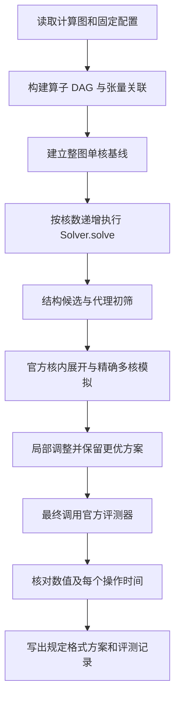

# 问题一：场景 A 下的切图与多核调度模型

## 摘要

问题一需要同时确定算子如何划分为子图、子图分配到哪个核心，以及各核心上的
子图执行顺序。切图能够增加并行机会，也会引入边界搬运和 Task 等待；较大的
子图有利于局部数据复用，却可能限制并行或增加片上存储换出换入。因此，仅按
算子数量或计算周期平均分配，不能可靠地得到较短的整体执行时间。

本实现采用“结构候选生成—代理成本筛选—精确模拟择优—局部调整”的求解方法。
模型以整体完工时间为第一目标，以时间相同时的额外搬运量为第二目标。图划分
保留张量共享关系，核内展开沿用官方 Step1/2/3，多核评分考虑流水并行、共享
DDR 带宽、内存复用依赖及 Task 等待，最后通过官方评测器逐操作核验。

本文描述本目录代码已经实现的方法。它是有限候选上的启发式搜索，不提供全局
最优性证明；代理估计不作为最终实验成绩。

**关键词：** 算子依赖图；多核调度；图划分；共享带宽；离散事件模拟。

## 1. 问题分析

### 1.1 三类相互关联的决策

输入是算子和张量构成的有向无环图，输出包含三类决策：

1. **切图：** 将所有非 COPY 操作划分为互不重叠的子图。
2. **分核：** 将每个子图分配给一个核心。
3. **排序：** 确定同一核心上的子图执行顺序。

场景 A 中，一个子图对应一个不可拆开的 Task。某个 Task 开始后，该核心要等
它结束，才能执行下一个 Task；Task 内部仍允许不同 Pipe 上的操作并行。
后继 Task 只能在前驱 Task 整体完成后启动，不能提前消费前驱 Task 的中间结果。

例如，一条很长的依赖链即使分配到多个核心，仍要按依赖顺序执行，并额外支付
切图搬运和等待开销。相反，一个 Task 中包含多条独立分支时，适当拆开可以让
多个核心同时工作。切图策略必须识别这些结构差异。

### 1.2 主要影响因素

| 因素 | 对执行时间或搬运量的影响 | 实现中的处理 |
| --- | --- | --- |
| 原始依赖 | 决定允许并行的范围 | 算子 DAG、子图 DAG 和操作执行图 |
| 算子周期与 Pipe | 同一 Pipe 串行，不同 Pipe 可重叠 | 四维负载估计及逐 Pipe 事件模拟 |
| 共享张量 | 同一 Task 内多个消费者可共用一次边界读入 | 按张量与消费 Task 去重 |
| 切图边界 | 产生 DDR 写出、读入 | 官方 Task 构建补齐 COPY |
| 同核相邻 Task | 即使无数据依赖，也有启动间隔 | 同核等待约束 |
| 跨核前驱 | 后继等待前驱完成及固定延迟 | 跨核释放时刻 |
| 全局 DDR 竞争 | 同时搬运的操作共享带宽 | 动态更新共享带宽池 |
| L1、UB 容量 | 可能引入换出、换入以及额外等待 | 官方 Step2/3 |
| 内存复用 | 新写入必须等待旧数据的读者结束 | 官方执行图中的 WAR/WAW 依赖 |
| 核内 FIFO 顺序 | 就绪操作也可能被同 Pipe 前序操作阻塞 | 固定 Pipe 队列及队首发射 |

## 2. 模型假设与适用边界

以下规则来自场景 A 的题意和评测语义，而非为方便求解而自行删除的约束。

1. 原图、算子周期、张量大小及位置已知，操作不重复计算；节点 ID 不要求连续。
2. 划分对象为非 `COPY_IN` / `COPY_OUT` 操作。边界 COPY 和存储换出换入由
   官方核内流程生成，不作为独立的人工分配变量。
3. 每个子图形成一个 Task，同一核心上的 Task 串行执行。
4. 不同 Task 之间的数据经 DDR 中转，即使两个 Task 分配在同一核心，也不能
   直接按场景 B 的规则跨 Task 复用 L1/UB 数据。
5. 每核包含 `PIPE_M`、`PIPE_V`、`PIPE_MTE2`、`PIPE_MTE3`，每条 Pipe
   同时执行一个操作；不同 Pipe 是否能重叠由依赖和资源条件决定。
6. DDR 为多核共享资源。只有涉及 DDR 的 COPY 占用共享 DDR 带宽；
   非 COPY 操作不会仅因属于 MTE Pipe 就被计入该带宽池。
7. 核内 Step1/2/3、容量管理、地址复用依赖及整数周期取整均服从官方实现。
8. 单核基线为整图形成一个 Task。优化比较覆盖 2～5 核，不通过修改硬件参数
   或单核基线获得加速比。

官方固定配置中，L1 为 524,288 字节，UB 为 131,072 字节，DDR 带宽为
60 字节/周期，同核相邻 Task 间隔为 100 周期，跨核依赖等待为 1,000 周期。
程序实际从 `config.txt` 读取这些参数，公式中的参数符号与配置对应。

代理成本初筛时暂不展开全部内存换出换入和带宽竞争，这属于计算上的近似；
进入精评的候选仍必须完整考虑这些因素。

## 3. 符号与决策变量

| 符号 | 含义 |
| --- | --- |
| $V,E$ | 非 COPY 算子集合及折叠后的算子依赖边集合 |
| $n=|V|$ | 参与划分的算子数 |
| $\mathcal T$ | 张量集合 |
| $b_t$ | 张量 $t$ 的字节数 |
| $p_v,\pi(v)$ | 算子 $v$ 的原始周期数与所属 Pipe |
| $N$ | 核心数 |
| $B$ | DDR 总带宽 |
| $M_{L1},M_{UB}$ | 每核 L1、UB 容量 |
| $\delta_s,\delta_x$ | 同核相邻 Task 间隔、跨核依赖等待 |
| $\mathcal P=\{V_1,\ldots,V_m\}$ | 算子划分，$m$ 为非空子图数 |
| $s(v)$ | 算子 $v$ 所属子图 |
| $c(s)$ | 子图 $s$ 所属核心 |
| $Q_c$ | 核心 $c$ 的 Task 有序序列 |
| $G_{\mathcal P}$ | 将每个子图收缩成节点得到的 Task 依赖图 |
| $a_s,C_s$ | Task $s$ 的激活时刻、完成时刻 |
| $\Omega_s$ | Task $s$ 经核内展开后实际执行的操作集合，包含生成的 COPY |
| $\alpha_i,\beta_i$ | 展开后操作 $i$ 的开始、结束时刻 |
| $\widehat d_s$ | Task 时长的乐观代理估计 |
| $d_s^{\mathrm{iso}}$ | 官方 Step3 给出的 Task 独立执行时长 |
| $T,A$ | 整体完工时间、总额外搬运字节数 |

实际搜索变量是 $(\mathcal P,c,Q)$。执行时刻由确定性调度和事件模拟计算，
不额外允许优化器随意延迟一个就绪操作来改变评测规则。

## 4. 联合优化模型

### 4.1 优化目标

设官方规则下的确定性评估函数为

$$
(T,A)=\operatorname{Eval}_A(G,\mathcal P,c,Q;B,M_{L1},M_{UB},\delta_s,\delta_x).
$$

采用字典序目标：

$$
\min_{\mathcal P,c,Q}\;(T,A)_{\mathrm{lex}}.
$$

即先比较完工时间；时间相同，再比较额外搬运量。这样无需人为指定将字节与
周期混合的权重。一个更快的方案可能搬运更多，程序会如实记录这一代价；
该准则并不意味着两个指标必然同时下降。

### 4.2 完备划分与唯一指派

$$
\bigcup_{s=1}^{m}V_s=V,\qquad
V_s\cap V_r=\varnothing\;(s\ne r),\qquad V_s\ne\varnothing.
$$

$$
c(s)\in\{0,\ldots,N-1\},\qquad
Q_c\text{ 恰好排列所有满足 }c(s)=c\text{ 的 Task}.
$$

因此，每个非 COPY 操作恰好进入一个子图，每个子图恰好进入一个核心序列。
允许某些核心没有 Task；强制用满所有核心可能增加通信成本。

### 4.3 无环与执行先后

若存在 $u\to v\in E$ 且 $s(u)\ne s(v)$，就在 Task 图中添加
$s(u)\to s(v)$。该图必须无环。进一步将各核心序列中相邻 Task 的先后边加入：

$$
G^+=G_{\mathcal P}\cup
\bigcup_c\{Q_c[j]\to Q_c[j+1]\}.
$$

$G^+$ 也必须无环。仅检查数据依赖图或分别检查每条核心序列，不能排除多个
核心互相等待形成的环；`check_schedules()` 对合并后的图统一检查。

### 4.4 Task 激活约束

令 $r(s)$ 为 $s$ 在本核心序列中的直接前项。其本核最早可用时刻为

$$
L_s=\begin{cases}
0,&s\text{ 是该核心的首个 Task},\\
C_{r(s)}+\delta_s,&\text{否则}.
\end{cases}
$$

跨核数据就绪时刻为

$$
R_s=\max_{p\in\operatorname{pred}(s),\;c(p)\ne c(s)}(C_p+\delta_x),
$$

空集合的最大值取 0。在合法序列中，同核前驱已包含在本核顺序约束内。
Task 在所有前驱结束并满足释放条件后尽早激活：

$$
a_s=\max\{L_s,R_s\}.
$$

等待时间取各条件的最大值，不对所有前驱等待逐项相加。同核相邻两个独立
Task 仍支付 $\delta_s$；首个 Task 不额外支付这项间隔。

### 4.5 核内执行与完成时刻

官方核内流程生成实际操作集合及依赖，包括原始数据依赖、Pipe FIFO 顺序、
内存复用的读后写和写后写约束。对于其执行边 $i\to j$，必须满足

$$
\alpha_j\ge\beta_i,\qquad
\alpha_i\ge a_s\;(i\in\Omega_s),\qquad
C_s=\max_{i\in\Omega_s}\beta_i,\qquad T=\max_s C_s.
$$

同一核心同一 Pipe 的操作按官方确定的顺序串行发射。非 COPY 操作的执行
周期为 $\max(1,p_i)$，保留官方对零周期输入的处理。

**Task 的实际时长不能直接等于“四条 Pipe 累计负载的最大值”。**
例如一个 200 周期的矩阵操作后接一个依赖它的 200 周期向量操作，即使两者
使用不同 Pipe，也至少需要 400 周期。核内依赖、FIFO 阻塞和带宽竞争都可能
使实际时长大于单纯的负载估计。

### 4.6 共享带宽与片上容量

对一个涉及 DDR 的 COPY，先按官方规则计算满带宽工作量：

$$
w_i=\max\left(1,\left\lceil b_i/B\right\rceil\right).
$$

在一段事件间隔内，若有 $k$ 个尚有剩余工作的 DDR COPY 同时传输，则每个
操作以 $1/k$ 的速率消耗上述工作量。新 COPY 加入、旧 COPY 完成时重新计算
剩余工作和预计结束时刻，完成事件向上取整到整数周期。

这里先将单次 COPY 的工作量取整，再进行共享带宽模拟；不能直接用未经取整的
字节流量近似替代官方评分。不同核心的 DDR COPY 使用同一个全局池。

容量条件可概括为：对每个核心 $c$、存储位置 $h\in\{L1,UB\}$ 及任意时刻，

$$
\sum_{t\in\mathcal R_{c,h}(\tau)}b_t\le M_h,
$$

其中 $\mathcal R_{c,h}(\tau)$ 表示展开后执行中实际占用该存储的有效驻留数据。
容量不足时，官方 Step2 插入必要的换出换入；Step3 将存储额度复用转化为
执行依赖。程序直接使用这些展开结果，不另行假定所有张量可以同时驻留。

### 4.7 搬运量口径

额外搬运量采用官方定义：

$$
A=A_{\mathrm{partition}}+A_{\mathrm{spill}}
  =D_{\mathrm{scheduled}}-D_{\mathrm{original}}.
$$

$D_{\mathrm{original}}$ 为原图 COPY 的总字节数，$D_{\mathrm{scheduled}}$
包含 Task 边界 COPY 和换出换入。代码分别报告划分增加量和换出换入增加量。

统计边界时，以“张量、生产 Task、消费 Task”的集合关系为依据。例如一个
张量从 Task A 传给 Task B 内的三个消费者，只需要一次边界写出和一次边界
读入，不应将同样的数据按三条算子依赖边重复计费。外部输入和最终输出的
搬运也必须计入；最终数值以官方展开后的 COPY 统计为准。

## 5. 图预处理与数据结构

### 5.1 从二部图建立算子 DAG

`tools.graph.Graph` 首先调用官方原图校验，再建立操作、张量及其关联集合。
将“生产者操作 → 张量 → 消费者操作”的依赖折叠为操作之间的有向边，
并利用官方辅助函数保留经过排除 COPY 节点传递的依赖。

同时保留 `producers`、`consumers`、`inputs`、`outputs` 和最终输出标记。
因此，用于拓扑排序的 DAG 与用于搬运计费的张量关系不会互相替代。

### 5.2 深度、关键路径和安全链

拓扑深度定义为

$$
\operatorname{depth}(v)=1+\max_{u\in\operatorname{pred}(v)}\operatorname{depth}(u).
$$

它用于识别计算阶段。另按原算子周期计算到汇点的最长路径，用于结构统计
和全图计算下界。拓扑排序使用堆及固定 ID 次序处理并列关系。

仅当操作 $v$ 有唯一前驱 $u$，且 $u$ 有唯一后继时，才把这段路径纳入同一条
安全链。链只是候选生成时的聚合单元，不会删掉原操作及其依赖，也不将整个
有分支的连通区域强行压缩成一个串行节点。

### 5.3 统一的划分表示

`canonical()` 将组内操作和各组按固定规则排序，去掉空组，使相同划分具有
一致表示。`Partition` 保存分组、算子归属、Task 依赖、拓扑序、代理时长、
边界流量和 DDR 工作量。其 `plan()` 方法统一生成规定格式的方案。

这一表示同时服务于候选去重、合法性检查和核内展开缓存，避免多处维护不一致
的算子映射。

## 6. 候选划分与代理成本

### 6.1 为什么采用候选搜索

联合优化需要在大量划分、核心指派和排列中选择答案，而且一次划分变化可能
改变换出换入、Pipe 顺序和共享带宽竞争。直接枚举全部组合代价过大；将 Task
时长固定后求一个简化整数规划，又可能忽略这些变化。

本实现保留联合目标，但用不同结构的候选覆盖主要选择，再通过统一精确评分
决定是否采用。代理模型负责节省搜索成本，不替代完整执行模型。

### 6.2 粗粒度候选

`candidates()` 生成以下候选。表中的目标组数均指非空分组的目标上限，
实际数量还受链数、分支数及权重分布限制。

| 候选 | 构造方法 | 主要用途 |
| --- | --- | --- |
| `whole` | 全部操作放入一个子图 | 单核基线及完整链的可行候选 |
| `chains_1/2/4` | 安全链按官方访问顺序排列，按周期累计切成约 $N,2N,4N$ 组 | 避免随意截断串行链 |
| `topo_1/2/4` | 单个操作沿拓扑序按周期累计分组 | 给链级划分提供更细的替代 |
| `components_1/2/4` | 将独立弱连通分量装入约 $N,2N,4N$ 个组 | 利用天然独立的分支 |
| `components_affinity` | 在独立分量装箱时考虑共享外部输入 | 减少不同组重复读入 |
| `levels_2/4/8` | 按拓扑深度分成若干阶段，再在阶段内分配独立分支 | 在较大范围内寻找阶段边界 |

独立分量装箱按最大 Pipe 负载从大到小处理。每次选择放入后最大 Pipe 负载较小
的组，而不是只比较总操作数。启用输入亲和时，还加入该组尚未拥有的输入
张量字节数除以带宽的代价。

连续拓扑分段用于保持依赖方向；所有结果仍会经过 `describe()` 的完整覆盖
和 Task 图无环检查，非法候选不会进入执行模拟。

### 6.3 结构细化候选

`refinements()` 在粗粒度搜索之后补充三类候选：

1. **固定深度窗口。** 尝试宽度 2、4、8、16 的深度窗口。在每个窗口内部找
   独立分量，再按最多 $N$ 组装箱。这样子图数可以随图的深度增长，不局限于
   少量与核数成比例的大子图。
2. **结构边界。** 在明显的分支扩展或张量收缩处设置切点。代码将“下一层
   宽度明显增大”或“输出字节数不超过输入的四分之一”作为候选切点信号。
   切点只是待验证的结构启发，是否采用由真实完工时间决定。
3. **链级张量亲和。** 沿安全链的拓扑次序逐一放置，综合最大 Pipe 负载和
   新增边界 COPY 代价，生成约 $N$、$2N$ 组的替代划分。

亲和构造过程中，当前链的组编号不小于其已放置前驱的组编号，避免构造反向
依赖。规范化之后的最终子图 ID 仅作标识，执行顺序仍由依赖和核心序列确定。

阶段切分不会额外设置“所有上一阶段任务结束，下一阶段才能开始”的全局屏障。
不同阶段之间仅保留原图真正存在的依赖。

### 6.4 代理时长与边界费用

对于子图 $s$，统计四条 Pipe 的工作量 $W_{s,p}$、子图内部依赖路径下界
$L_s^{\mathrm{int}}$，以及该子图边界 COPY 的满带宽总工作量 $W_s^{DDR}$：

$$
\widehat d_s=\max\left\{
L_s^{\mathrm{int}},\;\max_p W_{s,p},\;W_s^{DDR}
\right\}.
$$

其中 Pipe 负载加入边界 COPY 的占用，路径下界考虑必要的输入读入和输出写出。
同一张量在同一消费子图中只计算一次边界读入。最终输出即使没有下游计算
操作，也不能省略边界写出。

`Partition.copy_bytes` 是代理阶段的边界 COPY 总量；它不是最终的额外搬运量。
最终额外搬运量还涉及原图 COPY 的扣除及实际换出换入，必须从核内展开取得。

## 7. 核分配与执行顺序

### 7.1 关键路径优先级

对 Task 图按逆拓扑序计算后向路径长度：

$$
b_s=d_s+\max_{r\in\operatorname{succ}(s)}b_r.
$$

初筛时 $d_s=\widehat d_s$；核内展开完成后用 $d_s^{\mathrm{iso}}$ 更新调度。
选择已满足前驱调度条件的 Task 中 $b_s$ 最大者，优先安排可能推迟整体完工
的任务。程序还尝试按 Task 自身时长排序，补充一种偏重负载均衡的顺序。

这里的“已满足前驱调度条件”表示所有前驱已经被放入某个核心序列；真正执行
时仍要等前驱结束，并满足 Task 等待周期。

### 7.2 最早预计完成时间

设核心 $c$ 已安排任务的预计结束时刻为 $F_c$，其是否非空的指示量为 $I_c$。
将就绪 Task $s$ 追加到该核心后的预计完成时间为

$$
\widehat C(s,c)=
\max\left\{
F_c+I_c\delta_s,
\max_{p\in\operatorname{pred}(s)}
\left[\widehat C_p+\delta_x\,\mathbf 1\{c(p)\ne c\}\right]
\right\}+d_s.
$$

选择 $\widehat C(s,c)$ 最小的核心；并列时按核心已有完成时间和核心编号稳定
处理。算法得到核心指派和每核追加顺序，这两类决策在一次列表调度中同时产生。

该阶段不精确预测所有核心之间的 DDR 竞争，其输出仍是候选。随后的
`Engine.simulate()` 对候选的实际带宽竞争重新计算。

## 8. 精确评分与核内缓存

### 8.1 官方核内展开

`Engine.prepare()` 对一个合法划分依次完成：

1. 调用官方 Task 构建函数，按每个子图的真实输入输出生成边界 COPY。
2. 由 Step1 确定访问顺序。
3. 由 Step2 根据 L1、UB 容量插入换出换入。
4. 由 Step3 确定 Pipe 顺序及内存复用依赖，得到固定的核内执行图。
5. 将操作 ID、归属 Task、工作量、前驱计数、后继和 Pipe 队列编译为紧凑数组。

`Compiled.durations` 保存 Step3 的独立 Task 执行时间，供列表调度参考。
多核同时运行时，其他核心的 DDR COPY 可能延长实际 Task 时间，因此仍要
重新模拟整个多核过程。

### 8.2 缓存的边界

固定划分下，各 Task 的内部操作、边界 COPY 和换出换入已确定，改变分核或
同核顺序时可以复用核内展开。缓存以整个规范化划分为键，默认最多保留 8 个
展开结果，按最近使用顺序淘汰。

改变划分后会重新展开，当前实现没有将一次拆分近似成固定时长加减。
缓存是计算过程的复用机制，不改变题目的缓存容量或处理器执行规则。

### 8.3 事件模拟流程

模拟器维护每核当前 Task、四条 Pipe 的队首与正在运行的操作、操作前驱计数、
Task 剩余操作数，以及全局 DDR 剩余工作量。一次事件处理包含：

```text
推进 DDR 工作量到当前时刻
结束已经完成的操作，减少后继前驱计数，推进对应 Pipe
结束所有操作均已完成的 Task，更新后继 Task 的释放条件
激活满足依赖、核心可用时间及等待周期的队首 Task
在空闲 Pipe 上发射依赖已满足的队首操作
更新 DDR 共享下的预计结束时刻
跳到最近的操作完成或 Task 可激活时刻
```

运行态最多有 $4N$ 个在执行操作。通过剩余操作计数判断 Task 是否结束，
避免每个事件都扫描该 Task 的全部操作。执行资源、FIFO 次序、整数取整和
依赖条件保持与官方一致。

## 9. 下界剪枝与局部调整

### 9.1 固定划分下界

对当前划分，使用三种乐观时间下界：

$$
LB(\mathcal P,N)=\left\lceil\max\left\{
\max_{P\text{ 为 Task 路径}}\sum_{s\in P}\widehat d_s,
\frac{\sum_s\widehat d_s}{N},
\sum_s W_s^{DDR}
\right\}\right\rceil.
$$

三项分别表示依赖路径无法并行消除的工作、所有核心必须承担的平均工作量，
以及共享 DDR 最少需要的服务时间。如果该下界已经严格超过当前最好时间，
则这一固定划分不可能获胜，可以省略昂贵的核内展开。

代理评分高低只能决定优先尝试顺序，不能单独证明某候选无效。
上述下界用于安全剪枝，也不表示一定存在达到下界的调度。

### 9.2 拆分、合并与迁移

| 操作 | 当前代码采用的规则 | 需要重新计算的部分 |
| --- | --- | --- |
| 拆分 | 选择实测持续时间最长的 Task；有多个独立分量时分成两组，否则沿拓扑次序按周期分成两段 | Task 图、边界 COPY、核内展开、分核与完整模拟 |
| 合并 | 在同核相邻 Task 对中，尝试合并实测总时长最短的一对 | 同上，并重新检查 Task 图无环 |
| 迁移 | 从最晚完成的 4 个 Task 出发，尝试不同核心上的序首、接近原开始时刻的位置或序尾 | 全局 Task 判环及多核模拟，可复用原核内展开 |

这些规则给出少量可解释的局部候选。最长 Task 不一定处于最终关键路径，
最短相邻对也不一定是最好的合并对象，所以“提出候选”和“接受候选”必须分开。
只有精确模拟的字典序评分更优，才更新当前答案。

### 9.3 跨核数方案复用

在同一个 `Solver` 实例中，从小核数向大核数依次求解。已有的 $k$ 核方案可以
补 $N-k$ 个空核心，成为 $N$ 核合法候选。对这个候选重新模拟并保留后，
后续搜索只接受更优答案。

这保证同一次递增求解时，不会因可用核心数增加而丢掉已经找到的较好方案。
它不是跨程序运行的最优答案加载功能，也不是对所有搜索预算的单调性保证。

## 10. 完整求解流程

### 10.1 单种核数的搜索

`Solver.solve(N)` 的实际执行顺序如下：

```text
输入：原图 G，官方配置，核数 N，搜索预算和候选上限
输出：经精确模拟得到的最好方案 best

1. 构建整图单 Task 方案，作为初始候选。
2. 将本 Solver 中已有的较少核数方案补空核，加入比较。
3. 生成、去重并检查粗粒度候选，计算其代理列表调度成本。
4. 对“安全链按周期分为约 2N 组”的基础方案进行精评，作为统一对照。
5. 按代理成本顺序，精评最多 max_candidates 个其他粗粒度划分：
      下界超过 best 时间则跳过；
      否则进行核内展开；
      尝试关键路径优先和最长 Task 优先两种列表调度；
      对不同的核心序列进行精确模拟；
      只有字典序评分更优才替换 best。
6. 根据当前 best 尝试一轮拆分、合并，再尝试最多 moves 个任务迁移。
7. 生成固定窗口、结构边界、链级亲和三类细化候选。
      每类选择代理成本最好的一个划分；总数仍受 max_candidates 限制。
      逐个进行下界检查、核内展开、列表调度和精确模拟。
8. 再进行至多两轮拆分、合并；一轮没有改善则停止。
9. 保存 best，供后续更多核数的求解复用。
```

整个搜索中采用统一的接受准则：

$$
\text{accept}\iff
T_{\mathrm{new}}<T_{\mathrm{best}}
\quad\text{或}\quad
(T_{\mathrm{new}}=T_{\mathrm{best}}\ \text{且}\ A_{\mathrm{new}}<A_{\mathrm{best}}).
$$

该机制使已经找到的最好答案不会被较差候选替换。没有命中更好候选时，返回
当前保留的方案，而不强制接受一次拆分、合并或迁移。

### 10.2 从输入到最终输出



单用例入口 `main()` 为了复用较少核数方案，会先求解 2 到 $N-1$ 核，最后
求解 $N$ 核。批量入口对所选核数按递增顺序调用同一个 Solver。
直接在 Python 中调用一次 `Solver.solve(N)`，则只利用该实例此前已有的答案。

### 10.3 预算与停止条件

默认每种核数的搜索预算为 180 秒，粗粒度主搜索和结构细化主搜索各最多选择
3 个额外划分，任务迁移上限为 8。基础候选及局部拆分、合并另行处理，所以
`max_candidates=3` 不表示全过程仅执行三次模拟。

预算在候选之间检查；已开始的官方核内展开不会中途打断。单核准备、基础方案
和最终官方核验也会消耗时间，故实际命令耗时可能超过单个预算值。增大预算
能够尝试更多候选，但本实现不承诺跨运行的最终成绩随预算严格单调。

当前任务迁移位于粗粒度反馈之后，结构细化之后执行的是拆分、合并反馈。
说明中的步骤与实际代码一致，不把尚未加入代码的后续优化写成已实现功能。

## 11. 模型与代码的对应关系

| 数学或算法环节 | 代码位置 | 输入与输出 |
| --- | --- | --- |
| 原始数据校验、算子 DAG、张量关系 | `tools.graph.Graph` | 原始 JSON → 图结构和统计量 |
| 完备划分、Task 图、代理负载 | `partition.describe()` | 操作分组 → 合法 `Partition` |
| 粗粒度划分 | `partition.candidates()` | 图与核数 → 多种分组 |
| 深度窗口与结构细化 | `partition.refinements()` | 图与核数 → 结构候选 |
| $LB(\mathcal P,N)$ | `scheduling.lower_bound()` | 划分 → 乐观时间下界 |
| 后向路径优先级及预计完成时间 | `scheduling.list_schedule()` | 划分及 Task 时长 → 每核有序序列 |
| 固定核内执行图 | `Engine.prepare()` | 划分 → `Compiled` |
| 全局 Task 无环性 | `execution.check_schedules()` | 划分、核心序列 → 通过或报错 |
| $\operatorname{Eval}_A$ 的快速实现 | `Engine.simulate()` | 核内执行图、核心序列 → 时间、搬运与资源指标 |
| 拆分、合并及迁移候选 | `partition.feedback()`、`scheduling.neighbors()` | 当前答案及实测时间 → 邻域方案 |
| 字典序目标与最好答案保留 | `Solution.score`、`Solver.solve()` | 多个完整候选 → 当前最好答案 |
| 官方最终验收 | `Settings.evaluate()`、`assert_official()` | 输出方案 → 官方结果与逐操作差分检查 |

建议先阅读 `solve.py` 了解整体流程，再阅读 `partition.py` 和
`scheduling.py`，最后对照 `execution.py` 理解完整时序和带宽竞争。
公共接口的依赖与运行环境见[总 README](../README.md)。

## 12. 计算开销与实现选择

设原图有 $n$ 个计算操作、$e$ 条折叠依赖、$r$ 条算子与张量关联；划分有
$m$ 个 Task、$q$ 条 Task 依赖；核内展开后有 $n'$ 个操作、$e'$ 条依赖。

1. **图处理与代理估计。** 主要遍历操作、依赖和张量关联，拓扑堆操作与排序
   增加对数开销。该阶段不模拟每个实际操作的完整执行时间。
2. **列表调度。** 每个就绪 Task 比较 $N$ 个核心，其主要开销来自 Task 图遍历、
   优先队列及核心选择。题设 $N\le5$，核心选择的代价较小。
3. **核内展开。** 调用官方算法，成本受子图规模、张量生命周期和换出换入数量
   影响。细分成大量 Task 时，重复构造局部图也会产生明显成本。
4. **多核模拟。** 全局校验与初始化依赖于 $m,q,n',e'$。若共有 $H$ 个事件，
   事件循环只扫描至多 $4N$ 个在执行操作，并更新 DDR 池；相应的运行态处理
   约为 $O(HN\log(1+N)+e')$，不在每个事件重新遍历全部核内操作。
5. **重复候选。** 规范化划分、相同核心序列去重，以及最多 8 个条目的核内缓存，
   用于减少重复计算。改变划分的真实代价仍需重新求取。

因此，实现将精评预算集中在少量结构不同的候选上，而没有对所有窗口宽度、
所有子图数及所有迁移位置做无界枚举。缓存和计数器改善的是求解程序耗时，
不会直接改变某个固定方案的评测周期数。

## 13. 结果验证与实验指标

### 13.1 可行性验证

输出前必须通过以下检查：

1. 输入节点、边和参数满足官方格式及取值要求。
2. 全部非 COPY 操作被唯一覆盖，每个 Task 在核心序列中恰好出现一次。
3. Task 数据依赖图及合并核心顺序后的图均无环。
4. 核内展开满足 L1、UB 约束，保留必要的存储复用依赖和 Pipe 顺序。
5. 事件模拟能够推进至所有 Task 完成。

这些检查对应方案能否执行。仅有较小的代理成本，不构成可行性或性能证明。

### 13.2 精确性验证

`assert_official()` 不只比较最终 Makespan，还核对：

- 原评测器给出的各项搬运字节数；
- 每核 L1、UB 峰值；
- 每个 Task 的开始和结束时间；
- 通过 `(task_id, op_id)` 对齐的每个实际操作的开始和结束时间；
- 实际操作的完整覆盖数量。

最终核验不一致时不会写出通过验收的新方案。批量入口可以显式指定对照结果；
只有输入、配置、官方源码和 Python 版本一致，且提交方案完全相同，才复用
已有的完整核验，并再次对照本次模拟数值和全部 Task 时间。输出字段
`verification_source` 区分新运行官方评测和相同方案的核验复用。

### 13.3 加速比与统计口径

设用例 $i$ 的整图单核基线时间为 $T_{i,1}$，$N$ 核方案的官方时间为
$T_{i,N}$，则

$$
S_{i,N}=\frac{T_{i,1}}{T_{i,N}},\qquad
\overline S_N=\frac1K\sum_{i=1}^{K}S_{i,N},\qquad \overline S_1=1.
$$

批量评测采用先计算逐用例比值、再取算术平均的方式，而不是直接用所有用例
单核时间之和除以多核时间之和。不同核数的曲线必须使用相同用例集合。

除了主指标 $T$ 和 $A$，程序还记录以下诊断指标：

| 指标 | 用途及解释 |
| --- | --- |
| 划分额外字节、换出换入额外字节 | 区分切图边界代价和存储压力 |
| Task 数、活跃核心数 | 检查粒度和实际并行程度 |
| DDR 满带宽工作量除以 Makespan | 衡量传输服务量相对总时间的比例，不直接等同于硬件实测利用率 |
| Task 占用时间比例 | 包含 Task 内的依赖和带宽等待，不等同于计算单元利用率 |
| L1、UB 峰值 | 核对存储约束 |
| 搜索时间、官方核验时间 | 分离算法运行成本与评测成本 |
| 源码、输入、配置哈希 | 确认复现使用相同的程序和数据 |

`benchmark.py` 默认读取指定数据目录的全部用例，并按 2～5 核生成指标。
其 `--cases` 参数支持明确指定小范围用例。论文正式实验应覆盖题目要求的全部
用例；未完成精确评测的候选不能用代理时间填入正式实验表。

### 13.4 复现方法

在本提交目录根部执行以下命令，替换大写路径占位符：

```text
python -B -X utf8 Problem1/solve.py GRAPH.json -n 4 --config CONFIG.txt -o CASE_multicore_res.json
python -B -X utf8 Problem1/benchmark.py --data DATA_DIR --output OUTPUT_DIR --workers 2
python -B -X utf8 Problem1/plot_results.py OUTPUT_DIR
```

方案 JSON 只包含题目要求的两项映射；搜索信息写入独立文件。
批量记录包含 `metrics.csv`、汇总与复现信息，并分别保留方案和官方评测摘要。
绘图脚本从数值表重新统计平均值，不依赖手工填写曲线数据。

## 14. 模型评价与适用范围

本方法的主要特点是：使用图结构提出多种划分；保留张量共享关系避免重复计费；
将核内存储与流水规则交给固定官方流程；通过完整多核模拟决定是否接受改动。
因此，切图、分核、排序最终依据同一个执行目标比较。

当前方法仍有以下边界：

1. 只搜索有限候选，某些更好的切点、分组和任务顺序可能没有被生成。
2. 代理模型会影响候选优先级；代理排序不保证与真实时间排序一致。
3. 列表调度采用追加方式，局部迁移范围有限，不穷举所有序列。
4. 拆分依据最长实测 Task，合并依据最短相邻对，不等同于完整关键路径分析。
5. 共享 DDR 使 Task 时长随其他任务的运行重叠而变化，不能把独立 Task 时长
   直接相加当作多核最终时间。
6. 给定相同候选及固定配置，评分是确定的；软时间预算可能使不同机器评估到
   的候选集合不同，复现时应同时保留方案、候选记录和运行参数。

综上，程序给出的是通过官方规则核验的可行优良解。其可靠性来自完整约束、
精确评分和接受准则；其优化程度应由全量实验衡量，不能仅凭下界差距或候选
数量宣称已经达到全局最优。
