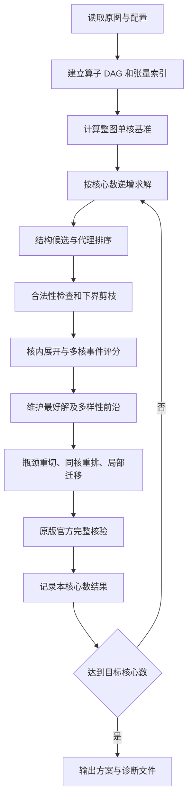

# 问题二：场景 B 下的切图、驻留复用与核间同步调度模型

## 摘要

问题二需要同时确定算子的子图划分、子图的核心指派和各核心上的子图顺序。
同一核心上的全部子图在执行阶段合并为一个 Task，前后子图能够复用片上驻留
张量；跨核依赖则通过写出、固定同步等待和读入实现。方案的执行时间取决于
计算负载、Pipe 并行、张量传输、片上容量以及这些因素形成的实际等待关系。

本实现采用“多结构候选构造—代理排序与下界剪枝—精确评测—瓶颈重切—顺序
调整—局部迁移”的联合搜索方法。以整体完工时间为第一目标，以时间相同时的
新增搬运量为第二目标。候选构造保留张量共享关系，评测使用官方核内展开和
多核事件机制，最终方案通过原版官方入口完整核验。

本文依次说明执行语义、数学模型、数据结构、各项搜索规则及其代码实现。
算法在有限候选上进行启发式搜索，并以可证明的时间下界进行剪枝和条件性停止。

**关键词：** 算子依赖图；张量驻留；多核调度；核间同步；共享带宽；下界剪枝。

## 1. 问题分析

### 1.1 三类联合决策

输入计算图包含操作节点、张量节点和依赖边。求解包含三类决策：

1. **划分：** 将全部非 COPY 操作划分为互不相交的非空子图。
2. **分核：** 将每个子图分配到一个核心。
3. **排序：** 确定各核心子图列表的先后次序。

三者会相互影响。分核改变跨核数据传输；划分和排序改变核内访问序列；访问
序列进一步影响张量最后使用位置、Spill、Pipe FIFO 和跨核 COPY 的发射时刻。
因此，即使两个方案的算子分核完全相同，完成时间也可能因子图粒度不同而改变。

### 1.2 子图、核心 Task 与操作的关系

子图是提交方案中的组织单位。执行时，核心上的所有子图合并为一个 Task。
官方先生成 Step1 顺序，再按核心子图顺序进行稳定分桶：不同子图按提交次序
排列，同一子图内部保持 Step1 的相对顺序，并重新检查拓扑合法性。

该序列参与后续内存处理和 Pipe 顺序生成。实际操作按依赖及 Pipe 就绪条件
发射，同核相邻子图之间没有额外的整体完成屏障。前一子图尚有操作在某条
Pipe 上运行时，后一子图在另一条 Pipe 上的操作可以在依赖满足后开始。

例如，同核两个子图之间的一条张量依赖，只要求消费者等到数据可用；该核上的
其他无关操作仍可推进。若生产者和消费者分属不同核心，则依赖需要展开成
源核写出、同步等待和目标核读入三个环节。

### 1.3 主要影响因素及处理位置

| 因素 | 对结果的影响 | 实现中的处理 |
| --- | --- | --- |
| 原图依赖与分支结构 | 决定可并行范围与关键路径 | 算子 DAG、弱连通分量、安全链、拓扑深度 |
| Pipe 工作量 | 决定核心及流水线负载峰值 | 四维工作量、关键路径列表分核 |
| 同核张量驻留 | 减少重复读写，但受容量限制 | 驻留亲和构造及官方内存展开 |
| 多消费者共享 | 同一目标核可以共用传输 | 按张量及源—目标核心集合计费 |
| 原始输入和最终输出 | 决定必须发生的 DDR 工作 | 边界 COPY 计数与全局下界 |
| 跨核固定延迟 | 小张量也可能引入明显等待 | COPY 释放条件、同步迁移候选 |
| DDR 并发读写 | 改变 COPY 实际持续时间 | 全局公平共享带宽模拟 |
| L1、UB 容量 | 引入 Spill、Reload 和生命周期约束 | 官方 Step2、Step3 |
| 存储复用 | 新写入须等待原数据访问完成 | 执行图中的 WAR/WAW 依赖 |
| Pipe FIFO | 就绪操作可能受队首阻塞 | 固定队列、队首发射与事件推进 |
| 子图粒度与顺序 | 改变访问序列、数据释放和等待位置 | 重切、连续段、细分、合并及重排 |

## 2. 模型假设与适用范围

### 2.1 执行规则

模型采用以下题意和评测规则：

1. 原始计算图、算子周期、张量大小和位置已知，算子恰好执行一次。
2. 划分对象为非 `COPY_IN`、非 `COPY_OUT` 操作。图输入输出、跨核传输及
   Spill 所需 COPY 由官方构建流程补充。
3. 每个核心合并为一个 Task，所有核心从时刻零进入操作就绪检查；具体首个
   操作的启动时间由本核依赖、Pipe 和跨核释放条件决定。
4. 同核子图共享本核 L1、UB，跨核张量按实际源—目标核心对经 DDR 传输。
5. 每核四条 Pipe 各允许一个操作在执行；不同 Pipe 可以在约束允许时重叠。
6. 涉及 DDR 的 COPY 共享全局带宽；是否参与带宽竞争根据操作类型及所访问
   存储位置判断。
7. 核内访问顺序、Spill 插入、内存复用依赖和周期取整遵循官方实现。
8. 核心数为 1～5，允许空核心。整个图放在一个核心上构成单核基准和初始可行解。

### 2.2 参数与计量单位

| 符号 | 参数 | 配置值 | 单位 |
| --- | --- | ---: | --- |
| $M_{L1}$ | 每核 L1 容量 | 524288 | byte |
| $M_{UB}$ | 每核 UB 容量 | 131072 | byte |
| $B$ | 全局 DDR 带宽 | 60 | byte/cycle |
| $\delta$ | 跨核 COPY 延迟 | 500 | cycle |

参数由 `SceneBSettings.read()` 从 `config.txt` 读取。公式中的时间工作量采用
cycle，数据量采用 byte；程序搜索预算采用现实中的秒，两种时间在记录中分别保存。

### 2.3 代理模型与精确模型的职责

代理模型保留计算工作、必要读写和依赖路径，暂时放松 Spill、FIFO 与带宽竞争，
用于候选排序和符合条件的下界判断。精确模型重新构建每核完整执行图，计算所有
实际读写、等待和事件时间。搜索是否接受一个候选，依据精确模型的字典序目标值。

## 3. 符号与决策变量

| 符号 | 含义 |
| --- | --- |
| $V,E$ | 非 COPY 操作集合及收缩后的操作依赖边 |
| $n=\lvert V\rvert$、$H$ | 操作数、最大拓扑深度 |
| $\mathcal T$ | 张量集合 |
| $b_t$、$h(t)$ | 张量字节数、原始存储位置 |
| $\operatorname{Prod}(t),\operatorname{Cons}(t)$ | 张量的非 COPY 生产者、消费者集合 |
| $F_t$ | 张量需最终写回的指示量 |
| $p_v$、$d_v=\max(1,p_v)$ | 原始算子周期、执行工作量 |
| $\pi(v)$ | 算子所属 Pipe |
| $\mathcal P=\{V_1,\ldots,V_m\}$ | 非空子图集合 |
| $s(v)$、$c(s)$ | 操作所属子图、子图所属核心 |
| $x(v)=c(s(v))$ | 操作所属核心 |
| $Q_c$ | 核心 $c$ 的有序子图列表 |
| $\Omega_c$、$E_c^{exec}$ | 核内展开后的操作及执行依赖 |
| $\alpha_i,\beta_i$ | 实际操作的启动、完成时刻 |
| $T,A$ | 总完工时间、新增 COPY 字节 |
| $q_t$ | 张量一次 COPY 的独占 DDR 工作量 |
| $\widehat T,\widehat D$ | 候选的时间代理、必要读写字节代理 |
| $L(P),L_N$ | 固定方案时间下界、所有 $N$ 核方案的时间下界 |

实际搜索变量是 $(\mathcal P,c,Q)$。操作时刻由确定性的官方执行过程计算，
属于方案的评估结果。下文用 $P=(\mathcal P,c,Q)$ 简写一个完整方案。

## 4. 联合优化模型

### 4.1 字典序目标

设完整评测函数为

$$
(T(P),A(P))=\operatorname{Eval}_B
(G,\mathcal P,c,Q;B,M_{L1},M_{UB},\delta).
$$

目标为

$$
\min_{P\in\mathcal F}(T(P),A(P))_{lex},
$$

其中 $\mathcal F$ 是通过划分校验、核内展开和完整执行校验的方案集合。
当时间相同时比较搬运量，可以保持主目标明确，同时利用时间相等候选改善资源开销。
`Solution.score` 直接返回 `(makespan, added_copy_bytes)`，所有阶段统一使用该顺序。

### 4.2 完备划分与唯一指派

$$
\bigcup_{s=1}^{m}V_s=V,\qquad
V_s\cap V_r=\varnothing\;(s\ne r),\qquad V_s\ne\varnothing.
$$

$$
c(s)\in\{0,\ldots,N-1\},\qquad
Q_c\text{ 恰好排列全部满足 }c(s)=c\text{ 的子图}.
$$

因此每个操作归属唯一、每个子图在核心序列中出现一次，空核心对应空列表。

### 4.3 子图依赖、同核顺序与执行合法性

若 $u\to v\in E$ 且 $s(u)\ne s(v)$，就在子图图中添加 $s(u)\to s(v)$。
该图须无环；对于同核子图依赖，还要求

$$
s\to r,\ c(s)=c(r)=c
\quad\Longrightarrow\quad
\operatorname{pos}_{Q_c}(s)<\operatorname{pos}_{Q_c}(r).
$$

`check_plan()` 完成这些低成本检查。官方随后检查按子图优先级形成的核内序列，
并在加入内存、FIFO 和跨核依赖后验证执行图。模型将这些操作级约束共同纳入可行域。

核心级商图可能含环：一条按时间先后执行的链可以先在核心 0、再在核心 1、
最后回到核心 0。其操作依赖仍可无环。保留同核多个子图，可以表达这种合法的
往返依赖；能否执行最终由展开后的操作关系决定。

### 4.4 核内数据依赖与 Pipe 串行

对于展开后的每条依赖 $(i,j)\in E_c^{exec}$，有

$$
\alpha_j\ge\beta_i.
$$

若同核某 Pipe 队列为 $(i_1,i_2,\ldots)$，则

$$
\alpha_{i_{k+1}}\ge\beta_{i_k}.
$$

对非 COPY 操作，$\beta_i=\alpha_i+d_i$。同核不同 Pipe 的重叠还取决于上述
依赖以及内存复用条件。例如依赖相连的两个不同 Pipe 操作仍必须前后执行。

核内排序先由官方 Step1 产生 `raw_seq`，再按 $Q_c$ 稳定分桶。该访问序列用于
Step2 和 Step3，后者产生逐 Pipe 队列与内存补边；实际发射遵循这些展开结果。

### 4.5 张量边界与跨核同步

令

$$
P_t=\{x(v):v\in\operatorname{Prod}(t)\},\qquad
C_t=\{x(v):v\in\operatorname{Cons}(t)\}.
$$

边界构造包括三部分：

1. $P_t=\varnothing$ 且 $C_t\ne\varnothing$ 时，每个消费核心补一次 COPY_IN。
2. $P_t\ne\varnothing$ 且 $F_t=1$ 时，每个生产核心补一次最终 COPY_OUT。
3. 对每个 $(p,c)\in P_t\times C_t$ 且 $p\ne c$，补一对跨核 COPY。

其中 $F_t=1$ 表示原图存在该张量的 COPY_OUT，或它没有非 COPY 消费者。
同一目标核上的多个消费者共享相应读入。源 COPY 归到该核最后一个生产子图，
目标 COPY 归到该核最早一个消费子图，以接入提交序列的优先级。

对于一对跨核传输，记源写出为 $o$、目标读入为 $i$，则

$$
r_i=\beta_o+\delta,\qquad \alpha_i\ge r_i.
$$

实际 $\alpha_i$ 还要满足本核依赖与 FIFO。释放时刻 $r_i$ 和启动时刻
$\alpha_i$ 分开保存，二者之差可用于分析同步后的排队。

直接操作边在同核保留；跨核时按其 `data_size` 创建中间张量和 COPY 对。
缺省大小为零时仍遵循官方至少一个周期的操作规则。官方构造本核张量视图时，
原始 DDR 张量的本地副本放入 UB，实际容量由展开后的存储位置约束。

### 4.6 DDR 共享带宽

对于一次传输 $b_i$ 字节的 DDR COPY，独占工作量为

$$
w_i=\max\left(1,\left\lceil\frac{b_i}{B}\right\rceil\right).
$$

在一段事件间隔中，若有 $k$ 个剩余工作大于零的 DDR COPY，则每个操作以
$1/k$ 的速率消耗独占工作量。新传输加入、现有传输完成时，评测器先更新剩余
工作，再重新计算预计结束时刻，并按官方规则向上取整到整数周期。

因此，COPY 的实际占用时间由并发状态决定。模型保留“先计算独占整数工作量，
再进行共享服务”的顺序；全部核心的读写进入同一带宽池。

### 4.7 L1、UB 容量与 Spill

对核心 $c$、存储位置 $h\in\{L1,UB\}$、任意时刻 $\tau$，要求

$$
\sum_{t\in\mathcal R_{c,h}(\tau)}b_t\le M_h.
$$

集合 $\mathcal R$ 由实际分配、释放、Spill、Reload 和张量物理重命名决定。
Step2 按访问顺序跟踪下一次使用，容量不足时优先换出后续使用最远的可选张量，
并排除当前操作正在使用的数据。当前操作的输入与新增输出应在最后使用释放
之前共同满足分配峰值限制。

官方维护持久 DDR 后备副本。若被换出的数据已有有效副本，可省去重复数据写出；
后续使用仍需相应读入。Step3 将空间复用转化为执行依赖，保证新的写操作等待
旧数据相关访问结束。候选的实际 Spill 量和驻留峰值均取自这一流程。

### 4.8 完工时间与搬运口径

$$
T=\max_c\max_{i\in\Omega_c}\beta_i,
$$

空核心的完成时间取零。官方搬运统计满足

$$
A=D_{scheduled}-D_{original}
 =A_{partition}+A_{spill}.
$$

$D_{original}$ 是原图 COPY 字节，$D_{scheduled}$ 包含边界 COPY 和实际 Spill。
跨核张量的一次源—目标连接涉及写、读两个传输方向；最终统计应包含这两个
操作，输入和输出读写也计入总量。

## 5. 图预处理与统一方案表示

### 5.1 双重图视图

`tools.graph.Graph` 调用官方输入校验，建立两组互补信息：

- 算子 DAG：将操作—张量—操作关系折叠，收缩被排除的原始 COPY 节点，
  保存 `preds`、`succs`、`order`，用于依赖判断和拓扑构造。
- 张量关联：保存 `producers`、`consumers`、`inputs`、`outputs` 和最终输出
  标记，用于共享输入、边界搬运和驻留亲和计算。

节点以 ID 字典索引。拓扑排序使用堆，先按指定优先级、再按 ID 处理并列情况，
使给定输入和优先级下的构造次序明确。

### 5.2 深度、后向路径与安全链

拓扑深度为

$$
\ell(v)=1+\max_{u\in pred(v)}\ell(u).
$$

空前驱集对应深度 1。按原始周期计算后向路径秩：

$$
r(v)=p_v+\max_{w\in succ(v)}r(w).
$$

深度用于切层，路径秩用于优先安排长路径上的操作。执行工作量使用
$d_v=\max(1,p_v)$，而 `Graph.rank` 使用原始 $p_v$；零周期节点在路径秩中
因此保持保守估计。

只有当 $v$ 的唯一前驱为 $u$，且 $u$ 的唯一后继为 $v$，才将二者加入同一
安全链。弱连通分量通过将依赖临时视为无向邻接得到；对层段或子图调用
`connected(nodes)` 时，遍历限定在该节点集合内部。

### 5.3 `Plan` 数据结构

`tools.plan.Plan` 为不可变对象：

```text
blocks[核心编号][该核心的子图序号] = 排序后的操作 ID 元组
```

组内 ID 排序用于规范化集合；真实组内操作访问顺序由官方调度器形成。
`Plan.build()` 去除空子图、保留空核心和子图列表顺序，便于哈希去重。
`assignment()` 导出操作到核心的映射，`padded(N)` 补充空核心。

`as_dict()` 按核心和列表次序连续编号子图，生成 `node_to_subgraph` 与
`core_schedules`。`block_graph()` 检查完整覆盖及重复操作，再建立子图依赖。
`arrange()` 先对整个子图 DAG 排序，再投影到各核心，得到可供核内展开的顺序。

### 5.4 代价模型索引与缓存

`CostModel` 保存每个张量的生产者、消费者、字节数、COPY 工作量及最终输出标记；
对每条生产—消费操作关系记录其共享张量的最大 COPY 工作量。直接操作边单独保存。

模型同时缓存三类结果：相同操作集合的 `unit()` 代价、相同深度切点的层段
连通分量、相同完整 `Plan` 的时间下界。`Solver` 保存已尝试方案集合以及少量
精评后的搜索起点，减少重复构造与重复评测。

## 6. 代理成本模型与下界

### 6.1 分组工作量与边界集合

对操作组 $S\subseteq V$，定义四维计算工作量

$$
W_{S,p}=\sum_{v\in S:\pi(v)=p}d_v.
$$

`unit(S)` 的外部输入集合为

$$
I(S)=\{t:\exists v\in S,\ t\in inputs(v),\ Prod(t)\cap S=\varnothing\}.
$$

边界输出集合 $O(S)$ 包含组内产生且需最终写回、没有消费者或被组外操作消费
的张量。令 $q_t=\max(1,\lceil b_t/B\rceil)$，则

$$
R_S=\sum_{t\in I(S)}q_t,\qquad U_S=\sum_{t\in O(S)}q_t.
$$

按组内拓扑序计算乐观路径：

$$
e_v=d_v+\max\left\{
\max_{u\in pred(v)\cap S}e_u,
\max_{t\in inputs(v)\cap I(S)}q_t\right\},
$$

$$
K_S=\max_{v\in S}\left(e_v+
\max_{t\in outputs(v)\cap O(S)}q_t\right).
$$

各空集合最大值取零。最终分组代理为

$$
\widehat d_S=\max\{K_S,\max_p W_{S,p},R_S+U_S,
W_{S,MTE2}+R_S,W_{S,MTE3}+U_S\}.
$$

该量用来装箱、分核和排列候选。整个组在精确场景 B 中仍按操作级规则执行。

### 6.2 固定分核的必要通信计数

对张量 $t$、核心 $c$，读写次数分别为

$$
n^{in}_{t,c}=\mathbf1\{c\in C_t\}
\left(\mathbf1\{P_t=\varnothing\}+|P_t\setminus\{c\}|\right),
$$

$$
n^{out}_{t,c}=\mathbf1\{c\in P_t\}
\left(F_t+|C_t\setminus\{c\}|\right).
$$

这些次数区分共享消费和跨目标核复制。例如同一源核产生的张量在同一目标核
被多个操作读取，其跨核读入次数仍为一次；新增目标核心才增加相应读写。

对每条直接操作跨核边 $e=(u,v)$，另加源 MTE3 和目标 MTE2 工作量
$q_e=\max(1,\lceil b_e/B\rceil)$。由此可得必要传输字节

$$
\widehat D(P)=\sum_{t,c}b_t(n^{in}_{t,c}+n^{out}_{t,c})
+2\sum_{e=(u,v):x(u)\ne x(v)}b_e,
$$

以及独占 DDR 工作总量

$$
Q(P)=\sum_{t,c}q_t(n^{in}_{t,c}+n^{out}_{t,c})
+2\sum_{e=(u,v):x(u)\ne x(v)}q_e.
$$

这两个量表示必要边界读写，不含实际 Spill。最终新增字节 $A$ 使用第 4.8 节口径。

### 6.3 固定方案资源下界

按操作分核累计 $W_{c,p}$，并把上述必要 COPY 工作量加入对应核心的 MTE2、MTE3：

$$
W_{c,MTE2}\mathrel{+}=\sum_tq_t n^{in}_{t,c},\qquad
W_{c,MTE3}\mathrel{+}=\sum_tq_t n^{out}_{t,c}.
$$

直接跨核边的 COPY 也作同样累计。资源下界为

$$
L_{res}(P)=\max\{\max_{c,p}W_{c,p},Q(P)\}.
$$

任一核心的一条 Pipe 必须完成其全部工作；全局 DDR 至少提供全部独占工作量
对应的服务。因此，忽略等待及额外 Spill 后，以上两项仍不会超过该方案的真实时间。

### 6.4 路径代理及其下界资格

对依赖 $u\to v$，令 $q_{uv}$ 为二者共享张量 COPY 工作量的最大值；没有共享
张量记录时取 1。代码沿拓扑序递推

$$
\widehat f_v=d_v+\max_{u\in pred(v)}
\left[\widehat f_u+
\mathbf1\{x(u)\ne x(v)\}(\delta+2q_{uv})\right].
$$

源点从零开始，$L_{path}(P)=\max_v\widehat f_v$。共享多个张量时，路径项取
其中最大的必要传输工作；直接边的完整字节量已在资源项中计入，路径缺省值
提供保守的最少 COPY 代价。

路径下界需要其中每条依赖都对应执行中必须存在的先后关系。代码用
`path_bound_valid` 检查收缩后的全部前驱关系是否可由直接操作边或张量关联表示。
满足时使用

$$
L(P)=\max\{L_{res}(P),L_{path}(P)\};
$$

否则使用 $L(P)=L_{res}(P)$。排序代理在两种情况下均采用
$\widehat T(P)=\max\{L_{res}(P),L_{path}(P)\}$，并以 $\widehat D(P)$ 作次级排序。
这一区分让排序保留结构信息，同时限定严格剪枝的适用条件。

只有当 $L(P)>T_{best}$ 时才剪枝。相等时保留候选精评机会，以便寻找相同时间、
更少新增字节的方案。

### 6.5 全局时间下界

对所有 $N$ 核方案，计算三类必要工作：

$$
L_{compute,N}=\left\lceil\frac{\max_p\sum_{v:\pi(v)=p}d_v}{N}\right\rceil,
$$

$$
Q_{min}=\sum_tq_t\left[
\mathbf1\{Cons(t)\ne\varnothing,Prod(t)=\varnothing\}
+\mathbf1\{Prod(t)\ne\varnothing,F_t=1\}\right].
$$

原图计算路径项取 $L_{graph}=\max_v r(v)$；路径资格不成立时该项取零。于是

$$
L_N=\max\{L_{compute,N},Q_{min},L_{graph}\}.
$$

三项分别来自每类 Pipe 的工作均分限制、输入至少读一次与输出至少写一次、
必要计算路径。它们放松具体分核、Spill 和排队限制，因此可作为最优时间下界。

### 6.6 近最优停止条件

设未知最优时间为 $T_N^*$，则 $L_N\le T_N^*\le T_{best}$。若

$$
1000T_{best}\le1005L_N,
$$

则

$$
\frac{T_{best}-T_N^*}{T_N^*}
\le\frac{T_{best}}{L_N}-1\le0.5\%.
$$

程序此时停止后续候选搜索并执行最终核验。该条件给出时间目标的差距上界；
新增字节仍按已找到候选中的最好值返回。`gap_upper_bound` 记录
$T_{best}/L_N-1$，供解释停止原因。

## 7. 结构候选生成与初始分核

### 7.1 构造原则

图中可能同时存在独立分支、长链、汇聚、张量收缩和前后阶段流水。
`CostModel.candidates(N)` 对这些结构分别构造完整方案，再统一进入精评。
每类候选明确规定分组单元、粒度和核心选择规则，使搜索覆盖不同的局部性与
并行方式。

| 候选名称 | 分组方法 | 粒度参数与分核方式 |
| --- | --- | --- |
| `components_1/2/4` | 全图弱连通分量装箱 | 目标组数 $N,2N,4N$，再列表分核 |
| `coarsen` | 合并细分分量方案中两个较轻的组 | 从 `components_4` 的组出发，重新列表分核 |
| `shared_inputs` | 分量装箱加入新增输入代价 | 目标 $N$ 组，装箱亲和权重 0.5 |
| `dfs_1/2/4` | 安全链按官方 DFS 首次出现顺序连续分段 | 目标组数 $N,2N,4N$ |
| `topo_1/2/4` | 单操作按拓扑序连续分段 | 目标组数 $N,2N,4N$ |
| `levels_2/4` | 按深度划成 2 或 4 个层段 | 每层段分量装入至多 $N$ 组 |
| `window_2/4/8/16` | 固定宽度深度窗口 | 每窗口装箱，再全局列表分核 |
| `resident_4/8/16` | 固定窗口逐段指派 | 累积工作量及生产者亲和直接分核 |
| `fork_reduce` | 分叉或张量收缩位置作为切点 | 段内亲和装箱，再列表分核 |
| `resident_forks` | 同一组结构切点 | 逐段驻留亲和分核 |
| `stream_h_k` | 深度 $h$ 分前后两段 | 前段 $k$ 核、后段 $N-k$ 核 |

目标组数还受可用分量、链数及累计工作分布限制。不同构造可能产生相同完整
方案，求解器在精评前去重。

### 7.2 独立分量装箱

`pack(units,count,affinity)` 将分量按 $\max_pW_{S,p}$ 降序处理。设已有箱 $j$
的 Pipe 负载为 $L_{j,p}$、已接触输入集合为 $I_j$，放入组 $S$ 的代价为

$$
C_{pack}(S,j)=\max_p(L_{j,p}+W_{S,p})
+\lambda\frac{\sum_{t\in I(S)\setminus I_j}b_t}{B}.
$$

选择代价最小的箱；并列时按已有负载总和、箱编号处理。普通装箱取
$\lambda=0$，共享输入候选取 $\lambda=0.5$。分配后更新四维负载和输入集合。

这个规则同时考虑主导 Pipe 和输入复用。输入共享项只用于候选构造，其权重
不会进入最终字典序目标。`coarsen` 在较细装箱中选 $\widehat d_S$ 最小的两个组
合并，构成一种较粗粒度方案。

### 7.3 连续分段与层段构造

`chunks()` 对给定单元序列按原始周期累计切段。若目标组数为 $K$，每段目标
工作量为

$$
\tau=\frac{\sum_{v\in V}p_v}{K}.
$$

当当前非空段的累计工作已达到 $\tau$，且还可以增加分组时，在下一个单元前
切开。安全链作为完整单元时不会在此步骤被拆断；拓扑单操作构造则提供更细候选。

对切点集合 $h_1<\cdots<h_q$，`layers()` 将深度划为
$[1,h_1],(h_1,h_2],\ldots$。切点所在深度归入前段，对应代码的 `bisect_left`。
各段先求内部弱连通分量，再分别装箱。全图依赖始终保留，层段只用于组织候选。

`levels_k` 的切点取 $\lceil Hj/k\rceil$；`window_w` 的切点取
$w,2w,\ldots<H$。窗口宽度小于最大深度时才生成相应候选。

### 7.4 分组关键路径列表分核

`dispatch()` 对分组 DAG 计算后向秩：

$$
b_s=\widehat d_s+\max_{r\in succ(s)}b_r.
$$

在前驱均已放置的组中，优先处理 $b_s$ 大的组。设核心 $c$ 的预计结束时间为
$F_c$，前驱组的预计完成时间为 $\widehat C_r$，定义

$$
R(s,c)=\max_{r\in pred(s)}
\left[\widehat C_r+\delta\mathbf1\{c(r)\ne c\}\right],
$$

$$
\widehat C(s,c)=\max\{F_c,R(s,c)\}+\widehat d_s.
$$

入组张量的跨核工作估计为

$$
X(s,c)=\sum_{t\in I(V_s):Prod(t)\ne\varnothing}
q_t\left|\{x(v):v\in Prod(t)\}\setminus\{c\}\right|.
$$

按元组

$$
\big(\widehat C(s,c)+2\eta X(s,c),\widehat C(s,c),F_c,c\big)
$$

选择最小核心，代码中列表分核的默认 $\eta=1$。随后令
$F_c=\widehat C(s,c)$，把组追加到 $Q_c$；亲和惩罚用于选择，不累加到保存的
完成时间中。

这一层的组完成时间是构造方案的启发式状态。进入精评后，执行由每核合并的
操作图重新展开，组之间采用第 4 节的操作级依赖。

### 7.5 驻留亲和分核

`resident_layers()` 按层段依次处理，累计每核四维负载。对待放置分量 $S$，
其外部生产者已经在较早层段分配。令

$$
X(S,c)=\sum_{t\in I(S):Prod(t)\ne\varnothing}
q_t|P_t\setminus\{c\}|,
$$

$$
J(S,c)=\sum_{t\in I(S)\setminus I_c:Prod(t)=\varnothing}q_t.
$$

选择核心的主代价为

$$
C_{resident}(S,c)=\max_p(L_{c,p}+W_{S,p})+2X(S,c)+J(S,c).
$$

三个部分分别代表累计负载峰值、跨核生产者代价、尚未读过的原始输入。
同一层段分到同一核心的分量合并为一个子图，追加到该核心已有列表。
这种方式使连续层段能够沿生产者所在核心保持数据局部性。

代价中的“驻留”表示分配亲和：实际张量是否保留在片上仍由容量和访问顺序
决定，并通过官方内存处理评估。

### 7.6 结构边界识别

记第 $h$ 层宽度为 $w_h$。当一个操作 $v$ 的深度 $h<H$，并满足下列条件之一，
将 $h$ 加入候选切点：

- 分叉信号：$|succ(v)|>1$，且 $w_{h+1}\ge\max(N,2w_h)$。
- 收缩信号：输入字节大于配置带宽的数值阈值，且输出字节不超过输入的四分之一。

第一项寻找分支明显展开的位置，第二项寻找数据规模明显收缩的位置。代码中
`incoming > bandwidth` 是小数据过滤的启发阈值，表示输入量超过约一个周期的
满带宽传输量；这些条件只生成切点候选，均需实际评测。

对相同结构切点，分别生成段内输入亲和装箱方案和驻留亲和方案，覆盖两种分核方式。

### 7.7 两阶段流水候选

对每个深度切点 $h\in\{1,\ldots,H-1\}$ 和核心配额 $k\in\{1,\ldots,N-1\}$，
前段使用 $k$ 个核心，后段使用其余 $N-k$ 个核心。令前后段各 Pipe 工作量为
$W^-_p(h),W^+_p(h)$，切面张量字节代理为 $D_h$，评分为

$$
C_{stream}(h,k)=\max\left\{
\frac{\max_pW^-_p(h)}k,
\frac{\max_pW^+_p(h)}{N-k},
\frac{2D_h}{B}\right\}.
$$

`streaming()` 用深度工作量前缀和更新两段负载，用张量最早生产深度和最晚消费
深度形成区间差分，扫描切面字节。按评分、字节量、切点、核心配额排序，最多
保留三个组合。各段内部求弱连通分量并装箱，分别映射到不重叠的核心组。

该构造允许后段在所需张量到达后推进，同时前段继续产生其他张量。代理式
概括负载与切面传输，精确评测补全同步、流水填充排空及存储因素。

## 8. 候选筛选、多样性前沿与瓶颈重切

### 8.1 候选优先级

初始候选按 $(\widehat T,\widehat D,名称)$ 排序并去重；先从每个名称前缀代表的
结构族取一个，再补充剩余候选。名称前缀取第一个下划线之前的部分。

在此基础上，`Solver.solve()` 根据规模和结构确定优先候选。设弱连通分量数为
$C$，以下规则按先后匹配：

| 条件 | 优先名称 |
| --- | --- |
| $n>4096,H>32,n\ge HC/2,C\ge N$ | `fork_reduce` |
| $C\ge N$ | `components_1` |
| $H^2>16n$ | `window_4` |
| $H>128$ | `fork_reduce` |
| 其余情况 | `levels_2` |

对应候选实际存在时才产生优先效果。首选为 `components_1`，且满足 $H>32$
或 $n>2HC$ 时，还优先安排 `coarsen`。这些规则用于有限时间内的访问顺序。

### 8.2 多样性前沿

初始构造和重切阶段对合法精评方案维护 `frontier`：

1. 按操作—核心映射去重，相同映射保留评分较好的方案。
2. 保留精确字典序评分最好的两个不同映射。
3. 在时间不超过前沿最好时间 1.3 倍的方案中，补充新增字节最少者。
4. 在时间不超过前沿最好时间 1.5 倍的方案中，补充子图数最少者。

重复项只保留一次，因此前沿至多四个方案。时间、流量和粗粒度三个角度给
后续搜索提供不同起点；最终答案始终由所有已精评方案中的最好评分决定。

### 8.3 依据实际时间线选择重切对象

按最终操作时间线累计每个子图、每条 Pipe 的持续时间：

$$
B_{s,p}=\sum_{i:s(i)=s,\pi(i)=p}(\beta_i-\alpha_i).
$$

选择 $\max_p B_{s,p}$ 最大的子图，并以子图 ID 处理并列。这里包括归属该子图
的 COPY 和 Spill 操作，DDR 操作的持续时间包含实际竞争影响。

`refinements()` 仅修改所选子图的分组。对内部深度切点 $h$，分为

$$
V_s^- =\{v\in V_s:\ell(v)\le h\},\qquad
V_s^+=V_s\setminus V_s^-.
$$

两段各自求内部弱连通分量并装入至多 $N$ 个组，其余子图的成员保持完整；
全部分组随后重新列表分核，因此其他子图的核心指派也可能随调度变化。

### 8.4 切点数量与轮次

- 大图 $n>4096$ 且内部切点超过 8 个时，保留层宽变化最大的四个位置、最前
  两个位置、中间位置和最后位置，去重后作为候选集。
- 其他情况切点超过 24 个时，在已存在的深度上均匀抽取 24 个。
- 最多重切两轮，每轮精评至多三个候选。

第一轮对非大图选择前沿中子图数最少的方案作为起点；其余轮次从最好解出发。
大图代理时间接近最小值 1% 以内的候选还优先按通信量和切点排列，保留时间
估计接近但边界代价不同的选择。

## 9. 同核排序、细分与合并

### 9.1 关键路径优先序

`CostModel.critical` 在保持拓扑性的前提下，按 $-r(v)$ 选择当前就绪操作。
它倾向于提前安排通向长后继路径的操作，使关键数据更早产生。

### 9.2 内存释放优先序

定义可估计的净分配量

$$
\rho(v)=
\sum_{t\in outputs(v):h(t)\in\{L1,UB\}}\frac{b_t}{M_{h(t)}}
-\sum_{\substack{t\in inputs(v),\ h(t)\in\{L1,UB\}\\|Cons(t)|=1}}
\frac{b_t}{M_{h(t)}}.
$$

代码对正容量的对应存储位置求和，按 $(\rho(v),-r(v),ID)$ 选择就绪操作。
新增输出少、可释放单消费者输入多的操作更靠前，关键路径作并列依据。

这是基于原始张量位置和消费者数量的静态近似。多消费者张量的实际最后使用、
局部 DDR 副本位置和 Spill 重命名由精评阶段计算。

### 9.3 顺序候选的具体形式

| 名称 | 构造规则 | 保留与改变的决策 |
| --- | --- | --- |
| `critical_runs` | 按关键路径拓扑序扫描，切成同核连续段 | 保留分核，重建子图和顺序 |
| `release_runs` | 按释放优先拓扑序扫描，切成同核连续段 | 同上 |
| `split_critical`、`split_release` | 将每个原子图按对应顺序二分 | 保留分核及原子图间顺序 |
| 上述名称加 `_4` | 将每个原子图四分 | 同上，粒度更细 |
| `merge_neighbors` | 合并同核相邻组中 $\widehat d_a+\widehat d_b$ 最小的一对 | 保留操作分核，改变局部粒度 |
| `subgraph_critical` | 按子图内最优先操作的秩作全局子图拓扑排序，再投影 | 保留分组及分核，改变顺序 |
| `merge_per_core` | 每个非空核心全部操作合为一个子图 | 保留分核，采用最粗粒度 |

连续段每段最多 32 个操作，最多生成 8192 个子图；超限时放弃该候选。
二分、四分按排序后节点的索引等分，空段由 `Plan.build()` 去除。
所有合并和细分都再次检查子图依赖，完整评测进一步检查核内优先级及执行条件。

### 9.4 多起点交错搜索

起点包括当前最好解，以及前沿中时间不超过最好值 1.3 倍、核心映射不同的方案。
候选按起点交错访问：先尝试各起点的第一个候选，再尝试第二个，以此类推。

候选首选规则为：存在跨核传输时优先二分释放序；否则深度超过 32 时优先
关键路径连续段；其余有 Spill 时优先释放连续段，其他情况优先二分释放序。
对深图且无跨核传输、子图数多于核心数的方案，进一步优先相邻合并。

排序阶段最多两轮，总配额由 `orders` 控制。一轮结束后最好评分未改善即停止；
有改善则以更新后的解建立下一轮起点。

## 10. 局部迁移与同步调整

### 10.1 负载候选

从实际时间线计算各核完成时刻 $F_c$，选择最晚完成核心 $c^*$。取该核心中
原操作总工作量最大的两个子图，作为整组迁移单元。

另外考察完全位于同一核心、同一子图的安全链。对链 $S$，统计其接触张量中
存在核外生产者或消费者的字节量 $D_{boundary}(S)$。按边界字节降序，再按
瓶颈核心上的链工作量降序，取前四条。每个单元尝试迁到其余核心。

这组候选同时覆盖重负载组与通信边界较大的链，目标核心最终由完整评分选择。

### 10.2 同步候选

对跨核依赖边分别提取：

1. 源操作后向路径秩最大的四条边。
2. 目标操作实际结束最晚的四条边。

合并去重后，对边 $u\to v$ 尝试把 $u$ 所在安全链迁到 $x(v)$，或把 $v$ 所在
安全链迁到 $x(u)$；要求被迁链的原操作全部位于同一源核心。

同步候选关注依赖位置，因此也能提名字节较小但含固定等待的传输。它使用路径
秩和实际结束时刻作为线索，最终效果仍由全量事件评估确定。

### 10.3 保持依赖的迁移实现

`relocate()` 扫描每个受影响子图，按原图拓扑位置排列操作，再按迁移后的目标
核心切成连续片段。若原序列依次为“留下、迁走、留下”，就保留三个片段，
随后调用 `arrange()` 重建子图依赖与各核序列。

该做法使一次迁移同时更新分组和顺序，允许表达迁移后仍需穿插执行的依赖。
构造失败或精评不可执行的候选记为拒绝，保留当前可行解。

### 10.4 大图预筛与候选配额

对 $n>4096$ 的图，先按迁移后的四维负载峰值与相关张量通信估计筛选。
迁移 $S$ 从 $a$ 到 $b$ 时，计算

$$
L'_{c,p}=L_{c,p}+\mathbf1\{c=b\}W_{S,p}
-\mathbf1\{c=a\}W_{S,p}.
$$

再对 $S$ 接触的张量统计组外生产、消费核心与目标核心不同的工作量。主预筛值
为 $\max_{c,p}L'_{c,p}$ 加两倍该通信估计。负载、同步两类分别保留至多
$\max(4,moves)$ 个提议，再构造方案并计算完整代理。

最终按代理排序，先为同步候选预留 $\lfloor moves/2\rfloor$ 个位置，再用其余
候选补足配额。迁移阶段从进入时的最好解生成一批候选；每个候选独立精评，
采用统一字典序接受准则。

## 11. 核内展开与精确事件评估

### 11.1 每核执行图的构建

候选评测通过 `tools.preview.evaluate()` 调用场景 B 评估流程，主要步骤为：

1. 调用官方 `derive_multicore_plan()` 校验原图与方案，获得算子、子图和核心映射。
2. 将同核全部非 COPY 操作合成一个局部 Task，接入本核张量及直接依赖。
3. 按图输入、图输出和实际跨核核心对插入 COPY，保存源写出与目标读入的关联。
4. 运行 Step1，并按提交的子图顺序稳定分桶，校验新访问序列。
5. 运行 Step2，插入容量约束下的 Spill/Reload，形成扩展图；新增操作关联到
   相应的前次或下次使用子图，用于输出时间线归属。
6. 运行 Step3 准备过程，生成存储复用依赖、固定 Pipe 顺序及操作索引。
7. 将每核准备结果与跨核连接交给全局事件模拟。

核内准备产生的执行图和 Pipe 次序在多核模拟中保持固定；多核同时运行引起的
DDR 竞争与跨核释放等待在全局时钟上重新计算。

### 11.2 操作状态和就绪条件

实际操作以 `(core_id, op_id)` 标识，保存状态、未完成前驱数、开始和结束时间。
每核每 Pipe 保存顺序数组、队首游标、就绪队列及执行槽。

一个操作能够进入就绪队列，需要同时满足：

- 状态为等待，核内前驱计数为零；
- 它是所属 Pipe 的当前队首；
- 跨核前驱已完成，且释放时刻已到。

释放时刻晚于当前时刻的操作进入跨核释放事件堆。Pipe 槽位可用时发射就绪
操作；同一 Pipe 后续操作通过前项完成后推进游标得到唤醒机会。

### 11.3 全局事件循环

从 $t=0$ 开始，每次执行以下过程：

```text
推进 DDR 剩余工作到当前时刻
完成所有到期操作，减少后继前驱计数，推进对应 Pipe 游标
唤醒已满足条件的核内后继和跨核 COPY_IN
处理到期的跨核释放事件
按核心与 Pipe 顺序发射可执行队首
若全部操作完成，结束
否则跳到下一操作完成或下一跨核释放时刻
```

新的 DDR COPY 发射以及已有 DDR COPY 完成时，重新计算共享带宽下的结束时间。
如果仍有未完成操作却不存在可推进事件，评测报告执行死锁；超过事件上限或
出现时钟不前进也作为候选失败处理。

### 11.4 候选评估的运行开销控制

`tools.preview` 在独立函数全局环境中适配官方核内准备。第二问使用的优化点为：

| 实现措施 | 等价依据与作用 |
| --- | --- |
| 完成游标计数 | Step3 的各 Pipe 游标在操作完成后递增，其和等于已完成操作数，减少逐事件全状态扫描 |
| 执行图边列表复制 | 对仅追加内存补边的准备过程复制图字典及边列表，减少无关深复制 |
| 相邻图索引复用 | 操作和边对象身份相同的连续只读调用复用索引 |
| 额度队列采用 `deque` | FIFO 内存额度消耗由 `popleft()` 实现，保持队列次序并减少列表首删移动 |
| 精简核内辅助日志 | 通过 AST 移除多核准备结果不引用的日志追加，保留调度状态更新及约束检查 |
| COPY 字节索引计数 | 根据 COPY 类型和关联张量大小计算相同的字节总量 |
| 循环回收状态管理 | 评估期间临时暂停循环垃圾回收，在 `finally` 恢复原状态，引用计数正常工作 |

适配器检查所依赖的官方源码模式，再生成候选评估函数。这些措施作用于 Python
实现的扫描、容器和分配成本，操作依赖、整数周期及多核带宽规则仍来自官方流程。

### 11.5 原版官方最终核验

`Solver.solve()` 返回前，对最终方案调用 `SceneBSettings.evaluate()`，得到原版
官方完整结果，并与候选精评结果比较整个字典。比较范围自然包含：

- makespan 与搬运字节各分项；
- 每核 L1、UB 峰值；
- 各实际操作的 Pipe、归属、启动、结束及持续时间；
- 核心 Task 与子图时间线；
- 跨核 COPY 的源写出时间、目标释放与读取时间。

若结果不同则抛出错误，求解入口不进入新方案写出步骤。最终返回值使用原版
官方结果，以此保证方案和报告采用一致的精确口径。

## 12. 完整求解流程与停止条件

### 12.1 单核基准与递增核心数

`Solver.single` 把整图非 COPY 操作放入一个子图、一个核心，并新调用官方
场景 B 入口计算基准。结果保存在当前 `Solver.known[1]` 中，同一实例再次读取
时复用该结果。

命令行求 $N\ge2$ 核时，依次调用 `solve(2),...,solve(N)`。每次从本实例中
核心数不大于目标的方案里选择字典序最好者，补空核心成为起点。追加空核心
保持已有操作的分配和执行条件，因此可行解能自然扩展到更多可用核心。

直接调用 `Solver.solve(N)` 时，它只利用该实例已有的结果；中间核心数的
依次求解由命令行或批量入口负责。

### 12.2 统一接受过程

每个候选依次经过：完整方案去重、结构合法性检查、必要下界计算、剪枝、精评。
接受条件为

$$
\operatorname{accept}(P)\iff
T(P)<T_{best}\quad\text{或}\quad
[T(P)=T_{best}\ \land\ A(P)<A_{best}].
$$

被拒绝或剪枝的候选记录原因。精评合法但未改善的候选在构造和重切阶段仍可能
进入多样性前沿，供进一步变换；`best` 仅按上述接受条件更新。

### 12.3 单种核心数的伪代码

```text
输入：原图、配置、目标 N、budget、candidates、orders、moves
输出：官方完整核验后的最好方案及搜索记录

1. 校验参数；准备整图单核结果和图代价模型。
2. 计算规模自适应预算，启动本核心数搜索计时。
3. 选择 known 中可用的最好解，补空核，初始化 best、attempted、frontier。
4. 计算全局时间下界 L_N。
5. 当 N > 1、candidates > 0 且尚未满足近最优条件：
      构造多结构方案，去重，计算时间与字节代理；
      按结构族覆盖及优先规则排序；
      在初始阶段截止前检查至多 candidates 个候选；
      对合法精评方案更新前沿，仅对严格改善者更新 best；
      继续至多两轮瓶颈重切，每轮精评至多三个方案。
6. 记录 initial_makespan。
7. 当仍有 orders 配额与阶段时间：
      从 best 和前沿建立不同分核的起点；
      交错访问各起点的排序、细分和合并候选；
      一轮无改善即停止，总计至多两轮。
8. 记录 ordered_makespan。
9. 在剩余预算内，从 best 生成一批至多 moves 个迁移候选并逐个评分。
10. 如最终保留的是补空核起点，补做该目标核心数的候选评估。
11. 调用原版官方评测，比较完整结果；核验成功后写入 known[N]。
12. 返回 best 与搜索、下界、核验记录。
```

### 12.4 从输入到输出



### 12.5 预算分配

用户预算为 $b_{user}$，实际每核心数搜索预算为

$$
b=\min\{b_{user},\max(18,10+0.0015n)\}\quad\text{秒}.
$$

| 阶段 | 数量限制 | 时间检查 |
| --- | --- | --- |
| 初始结构 | 至多 `candidates` 个待检查候选 | 已有候选记录后，到 $0.5b$ 停止继续 |
| 瓶颈重切 | 至多两轮，每轮三个 | 轮次在 $0.6b$ 前启动，候选在 $0.65b$ 前继续 |
| 顺序调整 | 至多两轮，共 `orders` 个 | 到 $0.9b$ 停止继续 |
| 局部迁移 | 一批至多 `moves` 个 | 到 $b$ 停止继续 |
| 最终核验 | 一次原版评测 | 搜索结束后完成 |

近最优条件会提前停止后续搜索。`candidates=0` 同时跳过位于该阶段内的重切；
`orders=0`、`moves=0` 分别关闭对应阶段。初始和顺序配额可能被合法性失败或
下界剪枝消耗，数量参数不等于实际精评调用数。

预算在候选之间检查，已经开始的构造或评估会完整结束。单核准备在搜索计时
之前，最终核验在搜索之后，因此命令的实际总耗时还包括这些部分。
规模自适应上限也意味着单纯增大 `--budget` 超过该上限，不会继续增加有效预算。

## 13. 模型与代码的对应关系

| 建模或算法环节 | 文件与接口 | 输入及输出 |
| --- | --- | --- |
| 图校验、算子 DAG、张量共享 | `tools/graph.py`：`Graph` | 原始 JSON → 图索引 |
| 拓扑、分量、安全链 | `Graph.connected()`、`chains()`、`topological()` | 节点与依赖 → 结构单元 |
| 方案规范化、序列与提交格式 | `tools/plan.py`：`Plan` | 有序分组 → 规范方案与 JSON |
| 子图依赖和同核顺序 | `block_graph()`、`check_plan()`、`arrange()` | 方案 → 检查或重排 |
| 分组代理、张量边界和下界 | `partition.py`：`CostModel.unit/estimate/lower_bound` | 组或方案 → 代价与下界 |
| 分量装箱、关键路径分核 | `CostModel.pack/dispatch` | 分组 → 核心有序列表 |
| 层段与驻留构造 | `CostModel.layers/resident_layers` | 切点与图 → 候选方案 |
| 阶段流水 | `CostModel.streaming` | 深度与核心配额 → 流水候选 |
| 结构候选、瓶颈重切 | `CostModel.candidates/refinements` | 原图或精评解 → 完整候选 |
| 顺序、细分与合并 | `scheduling.py`：`order_candidates` | 已分核方案 → 顺序邻域 |
| 负载、同步迁移 | `move_candidates()`、`relocate()` | 精评解 → 局部迁移方案 |
| 候选精评 | `tools/preview.py`：`evaluate` | 原图、方案、配置 → 完整场景 B 结果 |
| 最好解、前沿与预算控制 | `solve.py`：`Solution`、`Solver.solve` | 候选流 → 最好方案及记录 |
| 整图单核基准 | `Solver.single` | 原图和配置 → 官方单核指标 |
| 官方最终核验 | `tools/official.py`：`SceneBSettings.evaluate` | 最终方案 → 原版结果 |
| 批量统计与瓶颈指标 | `benchmark.py`：`run_case/diagnostics/summarize` | 用例与参数 → 方案及统计 |

建议先阅读 [solve.py](solve.py) 了解阶段控制，再阅读
[partition.py](partition.py) 和 [scheduling.py](scheduling.py) 中的规则，最后结合
[通用方案表示](../tools/plan.py) 与 [候选评估适配](../tools/preview.py) 查看合法性
和精评接口。

## 14. 计算开销与实现选择

### 14.1 图处理和代理计算

设操作数为 $n$、折叠依赖数为 $e$、操作—张量关联数为 $r$。建立图视图主要
扫描节点与关联；拓扑排序、邻接稳定排序及连通分量规范化另有排序开销。
对多生产者、多消费者张量建立操作关系时，还涉及相应生产者—消费者组合。

固定方案估计遍历操作、张量关联、直接操作边和拓扑依赖；源—目标核心组合
至多 $N^2$。由于 $N\le5$，核心组合较小，昂贵部分通常仍是精评的核内展开。

### 14.2 候选构造和局部搜索

分组列表调度对每个就绪组比较 $N$ 个核心；层段候选增加分量划分和排序次数。
流水扫描枚举约 $(H-1)(N-1)$ 个切点—配额组合，只对排序最前的三个构建方案。
重切、排序和迁移分别有明确轮数或配额限制。

代理缓存减少相同分组与层段的重复遍历，完整 `Plan` 去重减少重复精评；
操作—核心映射去重控制前沿数量。缓存随访问过的分组、切点和方案增长，
因此全过程内存开销还与搜索规模有关。

### 14.3 精评与最终核验

设展开后有 $n'$ 个操作、$e'$ 条执行依赖和 $H_{event}$ 次事件。
核内展开成本受访问序列、活跃张量和 Spill 数量影响；全局事件循环主要处理
至多 $4N$ 个在执行操作、事件堆和被完成操作唤醒的依赖。

总体运行时间应按实际访问候选拆分为

$$
t_{total}=t_{setup}+\sum_{P\in\mathcal C_{evaluated}}
\big(t_{build}(P)+t_{simulate}(P)\big)+t_{verify}+t_{io}.
$$

这一表达保留了候选执行图大小变化的影响。模型的资源时间下界使用 cycle，
程序的评估耗时使用秒，二者分别服务于方案质量与搜索成本分析。

## 15. 使用方法、输出与指标解释

### 15.1 运行环境和目录

求解使用 Python 标准库及题目提供的官方 Python 组件。保持如下项目相对路径：

```text
项目根目录/
├── code/
│   ├── Problem2/
│   │   ├── solve.py
│   │   ├── partition.py
│   │   ├── scheduling.py
│   │   ├── benchmark.py
│   │   └── README.md
│   └── tools/             # graph、plan、official、preview、experiment 等
├── 题目/
│   ├── code/              # 随题提供的官方组件
│   └── data/              # 计算图与 config.txt
└── results/               # 求解输出目录
```

`tools/official.py` 根据自身位置定位项目根目录和 `题目/code`。求解入口会将
`code` 加入模块搜索路径。命令中的 `-B` 禁止生成字节码缓存，`-X utf8` 指定
UTF-8 模式，便于在中文路径环境中运行。

### 15.2 单用例入口

在项目根目录执行，替换大写路径占位符：

```text
python -B -X utf8 code/Problem2/solve.py GRAPH.json -n 4 --config CONFIG.txt -o OUTPUT_multicore_res.json
```

| 参数 | 默认值或范围 | 作用 |
| --- | --- | --- |
| `graph` | 必填 | 原始计算图 JSON |
| `-n / --num-cores` | 必填，1～5 | 目标核心数 |
| `--config` | 图文件同目录的 `config.txt` | 官方评估配置 |
| `-o / --output` | `results/Problem2/single/<图名>_multicore_res.json` | 最终方案路径 |
| `--budget` | 45 秒 | 每核心数搜索软预算，按第 12.5 节计算有效值 |
| `--candidates` | 24 | 初始结构候选检查配额 |
| `--orders` | 16 | 顺序变换总配额 |
| `--moves` | 8 | 局部迁移总配额 |

数值配额须为非负整数，预算须为正有限数。目标为 1 核时返回整图单核方案；
目标大于 1 时按递增核心数求解，并写出目标核心数结果。

### 15.3 提交方案格式

输出 JSON 包含两个字段。下面以三个操作、两个核心示意格式：

```json
{
  "node_to_subgraph": {"1": 0, "2": 0, "3": 1},
  "core_schedules": [[0], [1]]
}
```

`node_to_subgraph` 的键为操作 ID 字符串，值为子图 ID；`core_schedules[c]`
给出核心 $c$ 的子图顺序。子图 ID 连续生成，操作覆盖由原图决定。方案旁另写
`_search.json` 和 `_official.json`，分别保存搜索记录和原版评测摘要。

### 15.4 批量入口

```text
python -B -X utf8 code/Problem2/benchmark.py --data DATA_DIR --config CONFIG.txt --cases 1 2 3 --workers 2 --output OUTPUT_DIR
```

`--cases` 明确列出待求用例编号，每例计算整图单核基准并求解 2～5 核。
`--workers` 控制按用例并行的进程数，输出目录应为空或尚不存在。
批量入口还接受与单例一致的搜索预算和候选配额。

每例使用一个 `Solver` 完成递增核心数搜索，保存单核摘要、每核数方案、精评
摘要及诊断。最终生成 `metrics.csv`、`summary.json` 和 `manifest.json`，后者
记录输入、配置、官方文件和算法源码哈希，以及环境和参数，供复现核对。

### 15.5 加速比与平均方式

对用例 $i$、核心数 $N$，定义

$$
S_{i,N}=\frac{T_{i,whole,1}}{T_{i,N}},\qquad
\overline S_N=\frac1K\sum_{i=1}^{K}S_{i,N}.
$$

分子为整图单 Task 的官方单核时间，分母为提交方案的官方多核时间。先对每例
计算比值，再取算术平均；各核心数使用相同的用例集合。
切分与并行可能改变 Spill 和 Pipe 重叠，因此加速比还反映这些执行结构变化。

### 15.6 搜索与瓶颈指标

| 字段或指标 | 解释 |
| --- | --- |
| `carry_makespan` | 进入本核心数搜索时继承的可行解时间 |
| `initial_makespan` | 完成初始构造和瓶颈重切后的最好时间 |
| `ordered_makespan` | 同核顺序阶段结束后的最好时间 |
| `final_makespan` | 全部阶段结束后的时间 |
| `partition_added_bytes`、`spill_added_bytes` | 边界增加字节和 Spill 增加字节 |
| `active_cores`、`subgraphs` | 实际使用核心数和子图数 |
| `core_finish`、`pipe_busy` | 各核心结束时刻、M/V Pipe 操作忙碌时间 |
| `mean_copy_queue_wait`、`max_copy_queue_wait` | COPY_IN 从释放到实际启动的平均和最大等待 |
| `ddr_byte_demand_fraction` | 总 COPY 字节除以带宽及 makespan 的理想需求比例 |
| `max_compute_pipe_fraction` | 最大 M/V Pipe 忙碌时间除以 makespan |
| `global_lower_bound`、`gap_upper_bound` | 全局下界及相对最优时间差距上界 |
| `search_seconds`、`verification_seconds` | 搜索耗时及最终原版核验耗时 |
| `pruned`、`rejected`、`preview_calls` | 剪枝数、拒绝数、实际候选评估调用数 |

DDR 字节需求比例使用连续字节量，未包含每条 COPY 的整数取整，解释为理想
服务需求。COPY 排队也可能与其他有用计算重叠，是否影响完工时间还需结合
最终关键依赖分析。并行进程的累计求解时间和墙钟时间分别统计。

## 16. 方法特点、适用边界与扩展方向

### 16.1 方法特点

1. 用完整方案统一表示切图、分核和顺序，所有候选使用同一评分和接受规则。
2. 张量关联保留共享消费与最终输出，通信代价按实际核心集合计数。
3. 多结构构造覆盖分支并行、链局部性、驻留亲和和阶段流水。
4. 利用实际操作时间线提出重切及迁移，再以精确评分决定收益。
5. 资源与路径松弛提供可解释的剪枝依据，近最优停止条件给出明确的时间差距上界。
6. 核内存储、Pipe 和多核共享 DDR 进入完整评估，最终核验覆盖全部官方输出。

### 16.2 适用边界

搜索范围由候选族、轮数、配额和时间预算共同限制。更好的分组或顺序可能存在于
未被访问的组合中；代理与真实评分也可能因 Spill、FIFO 和带宽竞争产生不同排序。

驻留构造使用静态生产者亲和，释放序主要近似单消费者输入的回收收益；瓶颈重切
按最大 Pipe 忙碌量选对象，同步迁移用后向秩和晚结束操作提名。这些指标反映
潜在瓶颈，完整执行评分决定其实际效果。

给定方案和配置，评测规则确定；采用软墙钟预算时，机器性能与并行进程争用会
影响候选访问数量。复现应同时保存输入、源码、参数、输出方案和搜索记录。

### 16.3 基于模型结构的扩展方向

以下方向从现有邻域和代价模型的边界推导，属于后续可研究的扩展。

| 方向 | 建模依据 | 具体实施方式 | 判断指标 |
| --- | --- | --- | --- |
| 成对链或分支交换 | 单向迁移可能同时增加目标核峰值和切边，两单元交换可改变可达邻域 | 从重、轻核心各取少量单元，计算交换后的四维峰值与张量核心集合，检查依赖后精评 | 精确 $T,A$、各核 Pipe 峰值、评估次数 |
| 生命周期感知重排 | 静态单消费者释放量无法完整表示共享张量的最后使用 | 围绕局部子图估计下一次及最后一次使用，生成相邻重排、细分或合并 | Spill 字节、内存峰值、Pipe 空闲及 $T$ |
| 实际关键链同步调整 | 静态后向路径和较晚结束时间未完整区分关键等待与可重叠等待 | 将 Pipe、内存复用和 COPY 释放依赖组成事件图，提取影响最终结束的链，再生成迁移 | 关键链等待、COPY 排队、完工时间及分析开销 |
| 收益与耗时驱动的预算分配 | 不同候选族的评估成本和可改善空间不同 | 在保留结构覆盖的基础上，按已评候选收益及成本调整后续配额，结合全局下界停止 | 平均加速比、搜索耗时、候选覆盖和下界差距 |

扩展应先通过输入覆盖、依赖、容量与精评一致性检查，再在固定用例集合、核心数
和预算下逐项消融；同时记录方案质量与程序耗时，以判断新增计算成本是否值得。
本文的算法流程、公式和代码对应表以已实现的方法为准。
