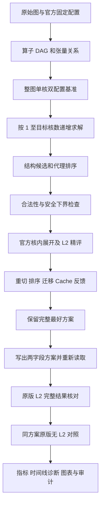

# 问题三：共享只读 FIFO L2 Cache 下的多核切图与调度模型

## 摘要

问题三在场景 B 的多核切图与调度框架上引入全核心共享的只读 L2 Cache。
需要同时决定算子划分、子图核心归属和核内子图顺序，使整体完工时间尽可能短，
并兼顾额外搬运量。切图既改变并行度，也改变跨核同步、片上存储压力和共享数据
的访问时刻；Cache 命中又由真实发射和完成顺序决定。因此，不能先固定划分，
再将全部读取时间乘上一个经验加速系数。

本实现采用“结构候选生成—安全下界筛选—官方精确评分—瓶颈反馈搜索”的方法。
候选模型考虑依赖路径、四条 Pipe 的负载、张量共享、阶段边界和存储释放；
精评完整保留 Step1/2/3、Spill/Reload、共享 DDR、独立 Cache 带宽和 FIFO 状态。
最终导出的方案重新读取，经原版官方评测器分别在无 L2、只读 L2 配置下核验。

程序从原图与官方配置独立求解，不导入第一、二问的主要算法，不读取其方案或
中间文件。本文只描述当前实现及当前版本的实验数据，不将代理值作为实测成绩。
有限候选搜索给出经核验的优良解；仅明确达到全局下界的配置具有相应最优性证书。

**关键词：** 场景 B；图划分；多核调度；只读 FIFO Cache；共享带宽；离散事件模拟。

## 1. 问题分析

### 1.1 三类关联决策

输入是 Op–Tensor 二部有向无环图，输出为完整方案 $P=(\mathcal P,c,\pi)$：

1. **切图：** 将所有非 COPY 算子划分为不重叠的子图集合 $\mathcal P$。
2. **分核：** 为每个子图选择一个核心 $c(s)$，允许存在空核心。
3. **排序：** 给出各核心的有序子图列表 $\pi_c$，通过它影响官方核内访问顺序。

场景 B 中，同一核心的全部子图共同形成一个 Task。一个子图在某条 Pipe 上
尚未结束时，后面的子图可以在其他 Pipe 上执行已满足条件的操作。子图顺序
会约束核内展开和 FIFO 顺序，但不产生整子图结束屏障，也不产生场景 A 的
同核 Task 启动间隔。跨核心只等待实际相关的生产、COPY 和同步条件。

### 1.2 Cache 为什么必须与调度联合考虑

同一张量在较早读取完成后，后续核心的 COPY_IN 才可能命中。若多个核心同时
发起首次读取，它们可能全部未命中。若读取之间穿插了大量其他张量，FIFO 淘汰
又可能使后续读取重新走 DDR。优先追求命中率还可能延迟计算关键路径。

因此，本题要平衡并行计算、重复读取、共享容量和时序。需要评价的是完整方案
的实际完工时间，而不是静态的共享张量数量或单独的 Cache 命中率。

### 1.3 主要影响因素

| 因素 | 作用 | 当前实现的处理 |
| --- | --- | --- |
| 数据依赖、分叉与归约 | 限制并行范围，决定阶段边界 | 算子 DAG、深度、安全链、子图 DAG |
| 算子周期与 Pipe | 节点数量相同不代表负载相同 | 按周期分块、四维 Pipe 装箱 |
| 子图粒度与核内顺序 | 改变流水交叠、访问顺序和 FIFO 阻塞 | 多粒度构造、连续段重排、细分与合并 |
| 共享输入与多消费者张量 | 可能避免重复搬运，也可能产生并发冷读 | 按张量及生产、消费核心集合建模 |
| 跨核边界及同步 | 增加 COPY_OUT、COPY_IN 和 500 周期等待 | 张量通信代理与实际跨核释放事件 |
| L1、UB 容量及分配次序 | 可能产生 Spill/Reload 和存储复用等待 | 官方 Step2/3 完整展开 |
| DDR 读写竞争 | 所有核心共享一个 DDR 带宽池 | 动态共享工作量模拟 |
| Cache 读带宽 | 命中读取使用另一独立共享池 | 双池分别推进和重算完成时刻 |
| Cache 容量与 FIFO 次序 | 决定插入、淘汰和后续可命中性 | 按真实完成事件修改 Cache 队列 |
| 读取发射与填充时刻 | 决定冷读是否重叠、能否复用 | 发射时查找，完成时尝试插入 |
| COPY_OUT 与超容量张量 | 写出不填充，过大对象无法驻留 | 原版官方规则 |
| 逻辑张量身份 | Spill 重命名不应破坏共享判断 | 使用 `logical_tid`，缺省为物理张量 ID |
| 整数周期与同刻事件顺序 | 可改变完成时间及 FIFO 内容 | 保留原版取整、退休、发射顺序 |
| 搜索成本 | 限制可检查的候选数量 | 安全剪枝、有限候选族、软件结果复用 |

## 2. 模型假设与适用边界

以下是当前程序遵循的题意及评测规则：

1. 原图、周期、张量大小和位置已知，不重复计算算子；ID 无须连续。
2. 划分对象为非 `COPY_IN` / `COPY_OUT` 操作。边界 COPY 和存储换出换入
   由官方流程生成，不额外作为人工指定的操作集合。
3. 每个非空核心形成一个整体 Task。同核子图可保留片上数据，不按每个子图
   强制写回、重新读入，也不加入整子图完成屏障。
4. 每核有 `PIPE_MTE2`、`PIPE_MTE3`、`PIPE_M`、`PIPE_V`，每条 Pipe
   同时执行一个操作；不同 Pipe 仍必须满足数据和存储复用依赖。
5. 多核共享 DDR 读写池及只读 Cache 读池；两个池互相独立，各自内部公平共享。
6. Cache 开始为空，替换规则固定为 FIFO；优化器不能改变容量、带宽或替换策略。
7. 调度按官方就绪和发射规则执行，优化器不能直接指定任意操作开始时间、
   人工插入空等或提前预取来绕过规定。
8. 允许不用满所有核心。添加空核心可保留本次第三问求解过程中已有的较优方案。
9. 所有代理近似只用于产生候选或安排评测顺序，最终成绩由完整官方执行决定。

| 固定物理量 | 符号 | 官方值 |
| --- | --- | ---: |
| 核心数 | $N$ | 1～5 |
| 每核 L1 容量 | $M_{L1}$ | 524288 B |
| 每核 UB 容量 | $M_{UB}$ | 131072 B |
| 共享 DDR 带宽 | $B_D$ | 60 B/cycle |
| 跨核同步延迟 | $\delta$ | 500 cycle |
| 共享只读 Cache 容量 | $C$ | 1048576 B |
| 共享 Cache 读带宽 | $B_C$ | 250 B/cycle |

实际参数由 `CacheSettings.read(config.txt)` 读取。`sensitivity.py` 的容量、
带宽变动是独立补充实验，不属于固定参数提交成绩。

## 3. 符号与决策变量

| 符号 | 含义 | 代码表示 |
| --- | --- | --- |
| $G=(V,E)$ | 收缩原始 COPY 路径后的非 COPY 算子 DAG | `Graph.ops/preds/succs` |
| $\mathcal T$ | 张量集合 | `Graph.tensors` |
| $b_t,P_t,C_t$ | 张量大小、非 COPY 生产者及消费者集合 | `Model.records` |
| $w_v,p(v)$ | 算子有效计算周期与 Pipe，$w_v=\max(1,\mathrm{cycles}_v)$ | `Model.work/pipe` |
| $\mathcal P=\{V_1,\ldots,V_m\}$ | 子图划分，$m$ 也是决策的一部分 | `Plan.blocks` |
| $s(v),c(s)$ | 算子所属子图、子图所属核心 | `Plan.assignment()` 等 |
| $\pi_c$ | 核心 $c$ 的有序子图列表 | `Plan.blocks[c]` |
| $\Omega(P)$ | 官方展开后全部操作，含生成的 COPY 和 Spill | 精评 Task、操作时间线 |
| $\alpha_i,\beta_i$ | 实际操作 $i$ 的发射、完成时刻 | `start/end` |
| $\kappa_i$ | 读取所用逻辑张量键 | `logical_tid` 或张量 ID |
| $\mathcal Q(\tau)$ | 时刻 $\tau$ 的 FIFO Cache 队列及其对象大小 | `cache_entries` |
| $R_{c,h}(\tau)$ | 核心 $c$、空间 $h$ 的有效驻留数据 | Step2/3 分配及复用依赖 |
| $T(P),A(P)$ | 完工时间、额外 COPY 字节 | `Solution.score` |
| $\widehat d(S),LB(P)$ | 构造代理时长、安全剪枝下界 | `unit/estimate/ordered_bound` |

真正被搜索的变量是 $(\mathcal P,c,\pi)$。操作时刻、Cache 命中、Spill 和带宽
竞争是该方案经过官方确定性执行后产生的结果，不是可独立指定的自由变量。

## 4. 联合优化模型

### 4.1 目标函数与搬运量

定义官方场景 B 只读 Cache 评估函数：

$$
(T,A)=\operatorname{Eval}_{B,L2}
(G,\mathcal P,c,\pi;M_{L1},M_{UB},B_D,\delta,C,B_C).
$$

采用字典序目标：

$$
\min_P\;(T(P),A(P))_{\mathrm{lex}},\qquad
T(P)=\max_{i\in\Omega(P)}\beta_i.
$$

额外搬运量为

$$
A=D_{\mathrm{scheduled}}-D_{\mathrm{original}}
 =A_{\mathrm{partition}}+A_{\mathrm{spill}}.
$$

先优化时间，时间相同再减少额外字节，不给周期与字节设置任意混合权重。
Cache 命中不会使一次 COPY 从官方搬运统计中消失；因此 $A$ 不等于实际走
DDR 路径的字节数。代理阶段的边界流量也不能直接代替 $A$。

### 4.2 完备划分与唯一指派

$$
\bigcup_{s=1}^{m}V_s=V,\qquad
V_s\cap V_r=\varnothing\;(s\ne r),\qquad V_s\ne\varnothing,
$$

$$
c(s)\in\{0,\ldots,N-1\},\qquad
\pi_c\text{ 恰好排列分配到 }c\text{ 的全部子图}.
$$

没有重复或遗漏算子，也没有重复或遗漏子图。`Plan.build()` 删除空组、保留
空核心，并规范化组内 ID；它不重新排列核心内的子图列表。

### 4.3 图无环与场景 B 的顺序约束

若 $u\to v\in E$ 且 $s(u)\ne s(v)$，在子图商图中加入 $s(u)\to s(v)$。
该子图图必须无环；同核子图顺序不得反转依赖。进一步的 Pipe 和存储复用
约束必须允许官方执行正常完成。

**不能要求核心商图无环，也不能将全部同核子图变成整体串行屏障。**
例如 $u\to v\to w$ 分别分配到核心 $0,1,0$，以三个子图表达时可以合法。
如果把 $u,w$ 合为同一个子图，则可能使子图商图形成环，必须拒绝。

当前 `check_plan()` 检查覆盖、子图图和同核依赖顺序；`ordered_bound()`
检查必要的逐 Pipe 约束；最终官方展开与模拟负责判断完整可执行性。

### 4.4 数据依赖、Pipe FIFO 与跨核同步

对于官方展开执行图中的数据或存储依赖 $i\to j$：

$$
\alpha_j\ge\beta_i.
$$

同核同 Pipe 操作按官方固定队列串行，队首未就绪时后项不能越过。不同 Pipe
可重叠，但不是无限并行。同核子图可以流水执行，不额外添加
$\min_{j\in V_r}\alpha_j\ge\max_{i\in V_s}\beta_i$ 这种整子图完成条件。

跨核 COPY 连接 $(o,r)$ 分别表示生产核心写出和消费核心读入：

$$
\alpha_r\ge\beta_o+\delta.
$$

即使 $r$ 命中 Cache，这条条件也必须满足。它等待的是相关 COPY_OUT 完成，
不是生产核心全部计算或整个子图结束。实际发射还要满足 Pipe 空闲和其他前驱条件。

### 4.5 片上容量、换出换入与地址复用

对任意时刻 $\tau$、核心 $c$ 和存储空间 $h\in\{L1,UB\}$：

$$
\sum_{t\in R_{c,h}(\tau)}b_t\le M_h.
$$

$R_{c,h}$ 表示执行中真实占用空间的物理数据，而非子图接触过的所有张量。
产生输出时先申请空间，输入在最后一次使用完成后才能释放；不足时 Step2
插入 Spill/Reload，Step3 将存储额度复用转成 WAR/WAW 等执行依赖。

因此，“子图张量大小之和小于容量”不是完整可行性判据；分别满足单个张量
大小限制也不能保证执行可行。非法候选由核内展开或最终模拟拒绝。

### 4.6 只读 FIFO Cache 的状态约束

令 $\mathcal Q(\tau)$ 按插入先后保存逻辑张量及其大小：

$$
\sum_{t\in\mathcal Q(\tau)}b_t\le C.
$$

对具有有效键、正字节数的 COPY_IN，发射时判断

$$
H_i=\mathbf 1\{\kappa_i\in\mathcal Q(\alpha_i^-)\}.
$$

此处 $\alpha_i^-$ 指该发射事件之前的状态，包含同一整数时刻已完成的退休与
填充事件，具体顺序仍由官方程序确定。执行期间即使对象被淘汰，也不回头更改
已经选定的读取路径。

完成时，如果对象尚未驻留且大小不超过 $C$，从队首淘汰直到空间足够，再将它
插到队尾；已经驻留则不移动位置。COPY_OUT 不填充 Cache。命中不刷新 FIFO
次序；一次命中读取若在完成前遇到淘汰，完成时仍可能重新插入。

同一张量同时发生的冷读取分别查询，均可能未命中；没有请求合并机制。
超容量张量不能驻留。零字节读取不参与正字节命中统计；其 DDR 资源占用、
最小周期及可能的零大小插入事件仍保留官方行为。

### 4.7 两个共享带宽池

读取命中时使用 Cache 池；未命中且涉及 DDR 的读取与所有 DDR 写出使用 DDR 池。
非 COPY 操作不因属于 MTE Pipe 就自动占用 DDR 池。

设传输 $i$ 在所选带宽池 $b\in\{D,C\}$ 的满带宽工作量为

$$
q_i^{(b)}=\max\left(1,\left\lceil\frac{b_i}{B_b}\right\rceil\right).
$$

若池内当前有 $k_b(\tau)$ 个剩余工作为正的传输，其剩余工作满足分段关系

$$
\frac{d\,r_i(\tau)}{d\tau}=-\frac{1}{k_b(\tau)}.
$$

操作加入或完成时重新分配共享速率，预计完成事件向上取整到整数周期。
整数事件间隔内较小工作量可能先耗尽，推进剩余工作时仍按官方分段规则处理。
不能用“总字节数 / 带宽”直接代替完整完成时间。

两个池分别推进，命中可能释放 DDR 带宽，从而间接帮助其他读取和写出；
但 Pipe 阻塞、同步和 FIFO 淘汰仍可能抵消收益。

### 4.8 为什么不以命中率直接优化

官方字节命中率为

$$
h=\frac{D_{\mathrm{hit}}}{D_{\mathrm{hit}}+D_{\mathrm{miss}}},
$$

无有效读取时按 0 处理。多搬运某些易命中的张量可能提高 $h$，却延长计算关键路径。
当前程序以 $(T,A)$ 选优，只把命中率及事件用于诊断和产生邻域，不把命中率作为
最终评分或静态的时间折扣。

## 5. 图预处理与数据结构

### 5.1 原图校验与依赖收缩

`tools.graph.Graph` 先调用官方原图校验，保存完整输入，同时建立非 COPY 算子
集合及算子—张量关联。通过官方辅助函数收缩排除的 COPY 路径，保留传递依赖。
原始 COPY 总字节仍保留，用于最终额外搬运量扣除。

图拓扑和张量计费使用两种互补表示：

- `preds/succs` 用于拓扑、深度、连通分量和合法性。
- `producers/consumers/inputs/outputs/final` 保留共享张量及最终输出语义。
- 原图直接算子边另行保留，不假定每条依赖都能对应一个普通张量。

### 5.2 深度、计算关键路径与安全链

$$
d(v)=1+\max_{u\in\operatorname{pred}(v)}d(u),\qquad
r(v)=w_v+\max_{u\in\operatorname{succ}(v)}r(u).
$$

空集最大值取 0。深度用于切阶段，$r(v)$ 是 `Model.rank` 的计算关键路径优先级。
`Graph.rank` 在通用结构统计中使用原始周期；问题三的目标相关排序及下界使用
`Model.work` 的至少一周期规则。

只有当 $v$ 有唯一前驱 $u$，且 $u$ 有唯一后继时，才将二者纳入同一条安全链。
链只是生成候选的聚合单位，原始操作和依赖始终保留。DFS 顺序由官方 Step1 产生；
拓扑顺序的并列关系用固定 ID 稳定处理。

### 5.3 存储释放优先序

对张量定义容量归一化大小 $\phi(t)=b_t/M_{\mathrm{space}(t)}$。代码对非 L1/UB
位置使用 UB 尺度作为排序代理，不改变正式存储归属。算子压力定义为

$$
\rho(v)=\sum_{t\in\operatorname{out}(v)}\phi(t)
-\sum_{\substack{t\in\operatorname{in}(v)\\|C_t|=1}}\phi(t).
$$

在可选拓扑节点中，优先选择 $(\rho(v),-r(v))$ 较小者：倾向先释放唯一消费者的
输入并减少新增输出占用。该值不等于真实峰值或 Spill 数量；实际容量行为仍由
Step2 决定。

### 5.4 方案、成绩与求解状态

`Plan.blocks[core][subgraph]` 用不可变元组保存完整分组及子图顺序。
`Plan.as_dict()` 生成两字段提交文件；`Plan.read()` 经官方计划解析后恢复方案。
`Solution` 将完整 Plan、完整精评结果和候选来源绑定保存，`score` 返回 $(T,A)$。

`Solver.known` 只保存同一第三问求解实例已获得的各核数答案。`Model` 保存输入
结构及候选代理，`Evaluator` 保存精确核内准备和执行复用内容，二者用途不同。

## 6. 候选划分与代理成本

### 6.1 搜索方式的选择

划分、核心归属、核内排序的组合数量很大；划分改变还会引起 Spill、FIFO 顺序
与共享带宽竞争的变化。将所有子图时长预先固定再优化一个简化整数模型，无法
完整反映这些变化。因此保留完整目标，通过多种结构候选覆盖主要选择，再用
统一的官方评分选优。

### 6.2 节点组的边界与时长代理

对节点组 $S$，定义边界输入、输出：

$$
I_S=\{t:C_t\cap S\ne\varnothing,\ P_t\cap S=\varnothing\},
$$

$$
O_S=\{t:P_t\cap S\ne\varnothing,\
t\text{ 为最终输出或 }C_t=\varnothing\text{ 或 }C_t\setminus S\ne\varnothing\}.
$$

按张量集合去重，令 $R_S=\sum_{t\in I_S}q_D(t)$、
$O_S^{time}=\sum_{t\in O_S}q_D(t)$，$W_{S,p}$ 为组内 Pipe $p$ 的计算量。
边界模式递推

$$
e_v=w_v+\max\left\{
\max_{u\in\operatorname{pred}(v)\cap S}e_u,\
\max_{t\in\operatorname{in}(v)\cap I_S}q_D(t)\right\},
$$

$$
L_S=\max_{v\in S}\left[e_v+
\max_{t\in\operatorname{out}(v)\cap O_S}q_D(t)\right].
$$

`Model.unit()` 返回的代理时长为

$$
\widehat d(S)=\max\left\{
\max_p W_{S,p},\
W_{S,MTE2}+R_S,\
W_{S,MTE3}+O_S^{time},\
R_S+O_S^{time},\
L_S\right\}.
$$

读写暂按 DDR 计算；不预测动态命中，也不展开 Spill。这个组级值用于构造，
**不是安全剪枝下界**。`boundary=False` 的局部性模式在 $L_S$ 中只计组内
计算路径；它与边界模式共用实现，用于保留不同的候选结构。

### 6.3 多粒度构造

| 候选或邻域| 具体构造及考虑的因素 | 实现 |
| --- | --- | --- |
| 独立分支与输入亲和 | 按 `N、2N、4N` 的粒度打包；平衡 Pipe 负载并减少输入重复读取 | `Model.seeds/pack/dispatch` |
| DFS / 拓扑分块 | 多核按计算工作量切分，DFS 保持安全链完整；单核用等节点数分段探索核内顺序 | `Model.seeds/chunks` |
| 分块与释放顺序联合构造 | DFS 分块后按存储释放优先序二分，避免可改进的粗方案在进入排序前被淘汰 | `split_order()` |
| 粗粒度探索 | 独立分支合并两个较短组；另构造深度二等分、四等分的阶段方案 | `Model.seeds` |
| 两阶段流水 | 枚举深度切点和前后阶段的核心数量；同时考虑两阶段计算与边界流量 | `Model.streaming` |
| 分层驻留 | 按深度段分组，累积核负载并考虑前驱核心和共享输入亲和 | `Model.waves` |
| 各阶段独立打包 | 每一深度段独立平衡，再对整体子图 DAG 统一分核，允许阶段之间更换核心归属 | `Model.staged` |
| 分叉与归约边界 | 保留驻留分配和各阶段独立打包两种方案；大图另评测释放优先细分 | `fork_reduce/resident_forks/forkrelease` |
| 核内重排、细分、合并 | 用关键路径、存储释放、DFS 顺序重建连续段；每个子图细分为 2/4 份，或合并同核子图 | `orders()` |
| 连续瓶颈重切 | 以子图最忙 Pipe 定位瓶颈，先重切粗方案，再根据新时间线重新定位 | `refinements()`、`recut()` |
| 排序后迁移 | 从实际最迟完成核心、跨核流量及末尾同步边生成迁移；包含零切边的负载平衡小链 | `moves()`、`relocate()` |
| Cache 反馈 | 对重复冷未命中、填充后再次未命中的热点，调整消费相位、消费核心及合法拓扑序 | `cache_neighbors()` |
| 合并后重切 | 将同核多个子图合成一个区域，按深度切分后重新打包和分核，扩大可达搜索范围 | `coarse_neighbors()`、`recut()` |

`staged()` 的层宽候选为 `2、3、4、6、8、12、16、24、32`；浅图枚举全部单切点，
深图保留首层、中点和宽度变化最大的切点。合并重切在切点较少时全部枚举，否则
取深度分位点和宽度变化大的位置。所有选择都来自输入结构，不按用例编号分支。

### 6.4 工作量分段与独立分支装箱

`chunks()` 对已排序的单位序列设置目标工作量

$$
W_{\mathrm{target}}=\frac{\sum_{v\in V}w_v}{K},\qquad K\in\{N,2N,4N\}.
$$

当前组累计达到目标且尚可增加分组时，才在下一个单位之前切开。DFS 单位为
完整安全链，拓扑单位为单个算子；实际组数可以少于 $K$。单核无需负载分核，
以等节点数切段探索访问次序。DFS 候选另按释放优先序二分，直接形成分组与
顺序联合候选。

`pack()` 按单位的最大 Pipe 工作量从大到小放置，选择最小的

$$
\max_p(L_{g,p}+W_{S,p})+
\lambda\sum_{t\in I_S\setminus Seen_g}q_D(t).
$$

平局比较原有总负载及组编号。普通装箱 $\lambda=0$；独立共享输入候选取 1，
分叉阶段打包取 0.5。该亲和项是候选生成参数，不是最终 $(T,A)$ 的权重。

### 6.5 深度阶段与流水核心组

`bands(cuts)` 按深度切点分段，在每段的诱导图中求弱连通分量。
`staged()` 在各段独立装箱再统一分核；`waves()` 累积已有 Pipe 负载并保持
生产者亲和。深度二等分、四等分的切点取 $\lceil D j/k\rceil$。

两阶段流水构造枚举深度 $h$ 及前段核心数 $a=1,\ldots,N-1$，用

$$
\max\left\{\frac{\max_p W_p^-}{a},
\frac{\max_p W_p^+}{N-a},\frac{2Q_h}{B_D}\right\}
$$

安排候选优先级，取前三种 $(h,a)$，分别将前、后阶段装入互不重叠的核心组。
$Q_h$ 是跨该深度边界的张量字节代理。该式没有完整计入同步、Spill 和 Cache，
只决定尝试顺序，不用于证明可达到的时间。

分叉切点依据下一层宽度明显增加，或输入字节大于输出字节四倍产生。
所有阶段之间只保留真实依赖，不增加全局阶段屏障。

## 7. 核分配与核内顺序

### 7.1 子图关键路径列表分核

对候选子图图逆拓扑递推

$$
b_s=\widehat d(s)+\max_{r\in\operatorname{succ}(s)}b_r.
$$

在前驱已经完成指派的子图中，优先处理 $b_s$ 较大者。这里的“已指派”仅用于
构造列表，并不表示实际计算已经完成。

设 $F_c$ 为核心代理可用时刻，$\widehat f_u$ 为前驱代理完成时刻：

$$
\widehat f(s,c)=
\max\left\{F_c,\max_{u\in\operatorname{pred}(s)}
[\widehat f_u+\delta\mathbf1\{c(u)\ne c\}]\right\}+\widehat d(s).
$$

令 $X(s,c)$ 为边界输入对应外核生产者核心的 DDR 读取工作总量：

$$
X(s,c)=\sum_{t\in I_s}q_D(t)
\left|\{c(s(u)):u\in P_t\}\setminus\{c\}\right|.
$$

它按生产核心集合去重，系数 2 近似一次写出和一次读入；不把一次张量传递按
全部消费算子边重复计费。边界模式选择

$$
\arg\min_c\big(\widehat f(s,c)+2X(s,c),\
\widehat f(s,c),F_c,c\big).
$$

`dispatch()` 的局部性模式额外加入当前核心尚未读取的外部输入工作量，并保留
传入分组顺序的稳定性。两种模式的预计时刻都是构造代理；真实场景 B 可以跨
子图流水，因此不把上述整组预计时长相加作为最终评分。

### 7.2 跨阶段驻留分配

`waves()` 不在各段重置历史 Pipe 负载，而对每个单位选择

$$
\arg\min_c\left[
\max_p(L_{c,p}+W_{S,p})+2X(S,c)+F_{\mathrm{input}}(S,c)
\right].
$$

它保留已放置生产者的核心归属、已读外部输入集合，并把本阶段同核单位组成一个
子图。独立阶段分配与驻留分配覆盖不同的负载、通信折中，最后都由精评决定。

### 7.3 顺序、细分与合并

`orders()` 生成以下邻域：

1. 以关键路径、存储释放、DFS 三种合法拓扑序，将同核连续操作重组为子图；
   连续段宽度为 32，通用 `runs()` 还限制总组数，防止生成过多碎片。
2. 每个原子图按关键路径或释放优先序切成 2 或 4 份，核心归属不变。
3. 按子图所含节点的关键路径优先级重排子图。
4. 合并同核相邻代理时长之和最小的一对子图，或合并同核所有子图。

组内 ID 在 `Plan.build()` 中规范化，直接改变节点列表书写顺序不会成为自由
调度变量。顺序优化通过改变子图成员、子图序列及 Step1 优先关系实现。
合并或重组可能产生依赖环，必须重新检查，不能因为原方案合法就直接接受。

## 8. 精确评分与软件结果复用

### 8.1 官方核内展开

给定完整 $P$ 后，精评依次执行：

1. 根据场景 B 合并每核子图并重建边界 COPY，保留提交的子图优先关系。
2. Step1 生成稳定核内访问序列。
3. Step2 按 L1/UB 容量插入 Spill/Reload，并记录逻辑张量身份。
4. Step3 建立内存复用依赖和每条 Pipe 的固定顺序。
5. 在固定核内执行结构上执行全局双带宽池和 FIFO Cache 模拟。

Step3 的核内准备沿用官方 DDR 条件下的顺序投影；不能先用全局 Cache 命中
修改这一步，再声称等价于官方评测。Cache 对时间的影响在后续全局执行中计算。

### 8.2 离散事件执行流程

`tools.preview.Evaluator` 复用官方第三问算法的独立函数环境。全局运行态包括
每核四条 Pipe 的队首、前驱计数、正在运行的操作、延迟释放堆、两个带宽池和
共享 FIFO 队列。每轮执行：

```text
将两个带宽池的剩余工作推进到当前时刻
退休已完成操作，更新 Pipe 队首和后继依赖
对完成的 COPY_IN 按官方次序尝试填充 FIFO Cache
唤醒已达到跨核释放时刻的操作
按核心、Pipe 及固定就绪顺序发射操作
COPY_IN 发射时查询 Cache，并进入相应带宽池
重算受影响池的预计完成时刻
跳到最近的完成或跨核释放事件
```

就绪操作仍可能被 Pipe 队首、存储复用前驱或跨核延迟阻塞。
没有可推进事件但仍有未完成操作时拒绝候选。整数取整及同刻处理次序保持官方实现。

### 8.3 软件复用与硬件 Cache 的区别

为减少求解耗时，`Evaluator` 另有两类**软件结果缓存**，与题目中的硬件 L2 无关：

- 核内准备以完整扩展图、容量、带宽的序列化字节为键，按最近使用顺序淘汰。
  按展开操作数计量，限额为 `max(4096, min(32768, 2*原图操作数))`。
- 完整事件结果的键还包含核心顺序、跨核连接、搬运统计、同步延迟、Cache 容量
  和带宽。原图操作数大于 8192 时最多保留一份，否则最多四份。

仅当完整执行内容相同时复用。子图标签不影响同一执行时，命中后重新生成子图
归属及其时间线元数据。使用完整字节相等判断，不依赖短哈希碰撞概率。

实现还优化 Step3 完成计数、只读索引、COPY 统计、额度队列及不被全局结果使用的
内部日志；不修改官方源文件。最终候选必须与未经这些软件加速的原版完整结果一致。

## 9. 下界剪枝与反馈邻域

### 9.1 全局时间与搬运量下界

记 `W_p = sum_{v:p_v=p} w_v`；`M_0` 为必要冷输入和最终输出的 DDR 独占周期总和；
`CP_0` 为只计计算、不计跨核通信的最长依赖路径；`I_0` 为下面的首尾搬运下界。

```text
LB_global(N) = max( ceil(max_p W_p / N) + I_0, M_0, CP_0 )
```

全局时间下界取各 Pipe 计算量均分加首尾搬运下界、必需的冷输入/最终输出 DDR 工作量、
有资格的计算关键路径三者最大值。存在自定义 `logical_tid` 别名时，不使用
可能重复计费的输入冷读取下界。被 COPY 收缩产生且官方通信模型未覆盖的路径，
不参与路径下界。

首尾搬运下界为“最便宜源算子的全部冷输入读取时间 + 最便宜汇算子的全部
最终输出写回时间”。第一个计算开始前必须完成其输入冷读，最后一个计算
完成后必须完成其输出写回；这两段无法与中间的计算区间重叠。
存在 `logical_tid` 别名或依赖表示不完整时停用这项加强。
额外 COPY 字节下界为至少一次必要输入/最终输出搬运减去原图 COPY 字节。
只有时间和搬运量**同时达到**全局下界才提前结束，记录 `certified_optimal=True`；
没有按近似差距阈值放弃搜索。

### 9.2 固定完整方案的下界

`estimate(P)` 在全局下界上加入三类限制：每核每 Pipe 的必要工作量、所有必要
COPY_OUT 的共享 DDR 工作量，以及含最乐观跨核读取和同步的关键路径。
对张量大小 `b`，独占 DDR 工作为 `q_D=max(1,ceil(b/B_DDR))`；容量允许时，
乐观读取工作为 `min(q_D,max(1,ceil(b/B_L2)))`，否则使用 `q_D`。
这相当于对可缓存读取给出最有利假设，故可用于下界；它不声称这些访问实际命中。

COPY_IN 乐观地使用允许的最快带宽，不把全部读取强算为 DDR，也不把估计
Spill 当成下界。
仅在下界**严格大于**当前最好时间时剪枝，保留等时间减少搬运量的机会。

候选即将精评时，另计算考虑子图顺序的下界：每个 `(子图, Pipe)` 设置开始、
结束两个虚点，间隔至少为该组的总计算量，并包围本组的算子；同核同 Pipe
相邻组之间按提交顺序相连。保留真实数据依赖及乐观跨核通信成本。
任意实际执行都满足这些差分约束，因此最长路是时间下界；该约束图若有环，
候选必定不可执行。不同 Pipe 之间没有额外的整子图屏障。
只依赖分核的原下界在会话内缓存，顺序下界仍逐完整方案计算。
这些固定方案下界仅用于相应候选，不能代替优化全部划分时的全局下界。

对应实现分别为 `Model.lower_bound()`、`Model.estimate()`、`Model.ordered_bound()`；
`Solver.solve()` 的 `consider()` 在调用精评前使用它们。下界超过实际精评时间时
程序直接触发断言；随机小 DAG、边界用例和已核验方案用于检查这些性质。

报告 `T / lower_bound - 1` 作为时间最优性差距上界；它不是实测误差，
不证明搬运次目标最优。启发式在一般大图上不保证全局最优。

### 9.3 下界的可解释形式与接受规则

全局计算下界由每条 Pipe 的总工作量、必要 DDR 服务和计算最长路径共同限制：

$$
LB_{\mathrm{global}}(N)=
\max\left\{\left\lceil\frac{\max_p W_p}{N}\right\rceil+I_0,\ M_0,\ CP_0\right\}.
$$

固定方案下界在此基础上加入各核 Pipe 的必要负载、必要 COPY_OUT 总工作量和
乐观跨核关键路径。普通张量允许缓存时，用

$$
q_F(t)=\min\{q_D(t),\max(1,\lceil b_t/B_C\rceil)\}
$$

作为读取的乐观工作量；不能缓存时使用 DDR 工作量。多张量的同一依赖取必要
等待的最大值，不把共享读按每条消费边重复累计。存在不能可靠表示的收缩依赖时，
停用对应路径项，不用不安全估计剪枝。

对固定子图序列，令 $z_v$ 表示算子完成时刻的松弛变量。每个“子图、Pipe”组
设置虚点 $a,b$，保留

$$
z_b-z_a\ge\sum_{v\in S_p}w_v,\qquad
z_v-z_a\ge w_v,\qquad z_b-z_v\ge0.
$$

同核同 Pipe 相邻组的虚点相连，真实操作依赖加入计算及乐观通信权重。
所有实际执行都满足这些约束，所以最长路是下界；不同 Pipe 不增加整体组屏障。

只有 $LB(P)>T_{\mathrm{best}}$ 时才剪枝。精评后的接受规则为

$$
\operatorname{accept}\iff
T_{\mathrm{new}}<T_{\mathrm{best}}
\ \lor\
(T_{\mathrm{new}}=T_{\mathrm{best}}\land A_{\mathrm{new}}<A_{\mathrm{best}}).
$$

安全下界负责证明某个固定候选不能胜出，代理优先级只决定先试谁，二者不能混用。

### 9.4 连续瓶颈重切

`refinements()` 依据实际时间线，计算每个子图各 Pipe 的持续时间总量，以其中
最大值定位瓶颈；不把可以重叠的四条 Pipe 直接相加作为繁忙程度。

对选中区域 $S$ 和切点 $h$，构造

$$
S^-=\{v\in S:d(v)\le h\},\qquad S^+=S\setminus S^-.
$$

两段分别求弱连通分量、装入至多 $N$ 个组，再与保留的其他组一起重新分核。
只改变瓶颈区域的划分，但统一列表分核可能改变其他组的核心归属。

小图优先从已经精评的深度二等分候选出发；不存在时使用较粗的精英方案。
下一轮从更新后的最好方案重新定位。大图直接从最好方案出发，限制切点数量。
这使第二轮可以处理第一轮改变后的瓶颈，而不是反复修改已经缓解的区域。

### 9.5 排序后的负载迁移与同步消除

`moves()` 使用排序后的实际时间线，提出三类单位：

- 最迟完成核心上的两个计算工作量最大子图；
- 按跨核张量字节排序的至多四条安全链；零切边时仍保留最忙核心上的重链，
  让无通信的链也能参与负载平衡；
- 计算关键路径较长的四条跨核边和消费者实际完成较晚的四条跨核边，
  尝试将端点所在的完整同核链移到另一端核心。

`relocate()` 按原拓扑序拆开被迁移节点与原组残余节点，避免将分离的两端
错误合并成有环子图；然后按拓扑约束重建核内子图序列。
本阶段对精英集合前两个方案生成候选，最终仍以完整精评接受。

### 9.6 Cache 事件反馈

`cache_neighbors()` 根据真实事件统计已请求或已填充张量的再次未命中字节，
选择压力最大的四个逻辑张量。候选包括：

1. 对涉及未命中的至多三个子图，将同核位置移动 $-2,-1,+1,+2$；
2. 将某张量分散在其他核心的消费者逐源核心迁到消费者最多的目标核心；
3. 按输入热点压力及计算关键路径重新生成合法拓扑连续段。

逻辑键不在原图消费者索引中时，不强行执行消费者聚集。所有相位变化仍须检查
依赖，不直接在时间线上人为添加等待。反馈最多两轮，一轮没有更优方案则停止。

### 9.7 合并后重切与保底

局部及 Cache 搜索使时间相对初始方案改善超过 5% 后，
`coarse_neighbors()` 将同核多个子图视为一个区域，按深度重新切分、装箱与分核。
它扩大可达邻域，仍受总软预算和精评次数限制，不保证每次都取得收益。

同一 Solver 中，较少核数的方案可补空核心成为新核数的初始答案。尾部空核心
没有操作、事件或带宽需求，原有事件顺序不变，因此扩展结果字段即可；完整官方
一致性测试及最终核验检查该性质。这仅保证本次求解已找到的答案不被丢弃，
不保证不同时间预算或不同软件版本之间的成绩单调。

## 10. 完整求解流程

### 10.1 从原图到提交文件

1. 原图建立算子 DAG、张量超边、独立分支、关键路径与存储释放优先序。
2. 直接官方计算整图单核两配置基准。较少核数的本题解可在同一求解进程中
   补空核成为初始候选。尾部空核无操作、无事件、无带宽占用，已有事件顺序不变，
   因此直接扩展空核结果字段；此性质由完整官方结果一致性测试及最终核验检查。
3. 生成多粒度独立分支、共享输入亲和、阶段流水、DFS/拓扑分块、分层驻留候选。
   另外在各拓扑层段内分别打包独立分支，再对整体子图 DAG 统一分核，允许阶段间
   更换核心归属。切点包括多种层宽、浅图各切点和分支宽度显著变化的位置。
4. 保留不同分核、较少子图和较少搬运的代表。小图优先对深度二等分方案重切，
   然后对更新后的最好方案再重切一次；大图两次都从最好方案出发。
   瓶颈按实际时间线中子图的最大 Pipe 工作量确定，避免把并行 Pipe 的时间直接相加。
   随后进行核内重排、细分和合并，最后针对排序后的前两个代表做负载与同步迁移。
5. 从真实 Cache 事件定位重复冷未命中和填充后的再次未命中，调整读取所在
   子图的相位、热点消费者归属及合法拓扑顺序。改进后重新生成反馈邻域。
6. 局部搜索将时间改善超过 5% 后，对同核多个子图合并重切，允许整体重新分核，
   跨越只修改单个子图的局部极小值；此步骤仍受同一时间预算约束。
7. 所有接受与替换以精确 `(T,A)` 为准，方案与结果整体保存在 `Solution` 中。
8. 导出后执行原版官方双配置核验；统计和图表只读取已核验结果。

候选按完整方案去重，不仅按分核去重。先评测传统候选，再使用预留名额评测
阶段打包候选。候选排序先安排各族的代表，再安排同族的其余方案；实际评测
数量仍受时间和调用上限限制。关键路径重排和存储释放重排分别作为独立候选族。
初始候选使用 `下界 + 必需 COPY 字节 / (10 × DDR 带宽)`
决定评测顺序，避免仅因极小的计算下界差异优先尝试大量通信的方案；这个排序项
不用于剪枝或最终选优。不设置代理必须改善若干百分比的硬门槛。
最佳完整方案始终保留，探索操作不能覆盖更好的实际成绩。大图和小图的候选优先级
依据规模、深度、独立分支数设置，不读取用例编号、第二问方案或历史最优答案。

初始阶段另外确定一个优先构造。记最大深度为 $D$、独立连通分量数为 $k$：

- 若 $n>4096$、$D>32$ 且 $n\ge Dk/2$，优先评测 `fork_reduce` 及其释放优先细分。
- 否则，若 $k\ge N$，优先评测整分支构造 `components_1`。
- 其余情形优先评测深度二等分构造 `levels_2`。

不存在、结构非法或被安全下界排除的候选不会因此获得豁免。该规则仅安排当前
可用候选的先后，后续仍保留其他候选族，最终接受只比较精确成绩。

控制过程可概括为：

```text
从原图生成并官方评测整图单核基准
对 N = 1, ..., 目标核数：
    以本次进程中已求得的较少核数最优解补空核，建立可行 incumbent
    评测传统初始候选，再评测各阶段独立打包候选
    对粗方案和更新后的最好方案依次重切
    对精英集合进行核内顺序优化，再按新时间线迁移
    从最好方案的真实 Cache 事件生成反馈邻域，最多反馈两轮
    若相对初始候选改善超过 5%，进行一次有限的合并重切
    每次仅在精确 (T,A) 改善时更新 incumbent
导出标准两字段 JSON，重新读取并进行原版双配置核验
```

多核精英集合保留按成绩排序的前三种不同分核，并在不超过最好时间 1.5 倍的候选
中补充最少子图、最少额外搬运代表，最多五份。单核没有分核差异，直接保留前三个
完整方案，防止丢失有价值的顺序。完整候选仍按完整 `Plan` 去重和评测，绝不把
分核相同等同于执行时间相同。邻域排序先安排不同类别的代表，其中关键路径重排、
释放优先重排、不同细分顺序分别计为不同类别；预算耗尽时不会强制完成所有类别。

两轮重切默认各精评三个候选。小图切点不超过 24 个时全部保留，更多时取 24 个
深度分位点；大图进一步限制到至多八个，包括首尾、中点及宽度变化较大的切点。
代理筛选不包含实际 Spill 与动态带宽竞争，因此后续仍完整调用第三问精评。

### 10.2 数据流与接口行为



单用例 CLI 从 1 核依次求到目标核数，只输出目标核数的提交文件。
直接调用一次 `Solver.solve(N)` 只使用该实例此前已经求出的答案。
`benchmark.py` 对每个原图独立建立 Solver；三问之间不共享搜索状态或方案文件。

### 10.3 预算、剪枝和停止条件

默认每核数搜索上限 45 秒，初始精评至多 18 个（多核时其中 4 个用于阶段打包）、结构邻域至多 32 个、
Cache 邻域至多 16 个、反馈至多 2 轮；触发合并重切时额外精评至多 16 个。
结构名额在多核时分为重切 6、排序 18、迁移 8；单核只进行排序。
正在执行的完整评测不会强行中断，
所以时间上限是软上限；整图基准和最终核验单独计时，不挤占搜索预算。
程序直接使用用户传入的搜索预算。

默认配置的累计阶段截止时刻如下，均从该核数的搜索开始计时：

| 阶段 | 单核截止比例 | 多核截止比例 | 默认精评调用上限 |
| --- | --- | --- | --- |
| 传统初始候选 | 50% | 50% | 单核 18，多核 14 |
| 各阶段独立打包 | — | 70% | 多核 4 |
| 瓶颈重切 | — | 76% | 两轮合计 6 |
| 核内排序 | 78% | 86% | 单核 32，多核 18 |
| 排序后迁移 | — | 94% | 8 |
| Cache 反馈 | 100% | 100% | 合计至多 16 |
| 触发后的合并重切 | — | 100% | 16 |

生成、去重、合法性检查和下界计算也计入预算。阶段没有用完时间时立即进入下一
阶段；关闭邻域或修改候选数后，截止比例由 `solve()` 中相应分支调整。
不依靠加载历史优胜方案保证成绩。补空核只复用同一第三问求解进程的内存状态。

效率改进包括：分核下界复用；完全相同核内准备及执行过程的有界复用；Step3
完成计数、额度队列和无用内部日志处理；达到两个全局下界时停止搜索。
复用键包括完整执行内容及物理参数，避免以相似结构代替相同执行。

候选顺序确定、无随机搜索；在时间截断生效时，硬件负载可能改变停止位置。
需要严格按候选数重跑时应提高 `--budget`，并确认 `budget_exhausted=False`。
实验记录输入、配置、官方源码和本实现源码 SHA-256、Python 版本、参数与逐次搜索记录。

## 11. 模型与代码的对应关系

| 文件 | 职责 |
| --- | --- |
| `model.py` | 张量通信模型、安全下界、独立生成的结构初始方案 |
| `search.py` | 核内重排、切分合并、瓶颈区域重切、迁移及 Cache 反馈邻域 |
| `solve.py` | 搜索控制、字典序选优、标准提交文件及原版官方核验 |
| `diagnostics.py` | 分析真实 Cache 事件、核心负载、带宽与通信等待 |
| `benchmark.py` | 用例覆盖统计、1～5 核实验、逐配置记录和汇总 |
| `plot_results.py` | 同方案双配置曲线及 Cache 加速比图 |
| `sensitivity.py` | 固定本题最终方案的容量/带宽补充实验，独立存放结果 |

复用 `tools/graph.py`、`plan.py`、`official.py`、`preview.py` 和
`experiment.py` 的通用能力。求解、验证及实验只依赖 Python 3.10+ 标准库。
可选绘图需要 ReportLab；导出 PNG 另需 pypdfium2。官方代码从
`题目/code` 只读导入，原始数据和配置不修改。

| 数学或算法环节 | 具体接口 | 输入 → 输出 |
| --- | --- | --- |
| 原图校验、COPY 收缩、张量关联 | `tools.graph.Graph` | 原始 JSON → 算子 DAG 和张量集合 |
| 标准方案表示及结构合法性 | `tools.plan.Plan/check_plan` | 有序分组 → 标准映射及合法性 |
| Pipe 工作量、边界、关键路径代理 | `Model.unit/pack/dispatch` | 节点组 → 分组和核内子图序列 |
| 多粒度、阶段、驻留、流水构造 | `Model.seeds/staged/waves/streaming` | 原图和核数 → 完整候选 |
| 全局时间与搬运量下界 | `Model.lower_bound/minimum_added` | 图、核数 → 全局证书基准 |
| 固定分核和顺序下界 | `Model.estimate/ordered_bound` | 完整方案 → 安全时间下界 |
| 顺序、细分和合并 | `orders/split_order` | 当前方案 → 固定或重组顺序候选 |
| 瓶颈切分和迁移 | `refinements/recut/moves/relocate` | 方案及时间线 → 合法邻域 |
| 真实 Cache 反馈 | `cache_neighbors` | Cache 事件 → 相位、归属、顺序候选 |
| 精确核内及事件结果复用 | `tools.preview.Evaluator` | 完整方案 → 官方语义完整结果 |
| 接受与搜索控制 | `Solution.score/Solver.solve` | 多个候选 → 当前最好完整答案 |
| 文件级最终验收 | `save_verified` | 导出再读入的方案 → 原版双配置结果 |
| 对照、汇总与审计 | `benchmark.run_case/summarize/compare` | 已核验结果 → CSV、JSON、哈希 |
| 诊断与可视化 | `diagnostics.analyze/plot_results.plot` | 官方事件和统计 → 瓶颈指标、曲线 |

建议先阅读 `solve.py`，再看 `model.py` 的候选与下界、`search.py` 的邻域，
最后阅读 `tools/preview.py` 和官方评测实现核对完整执行语义。
第一、二问的主要算法模块不在第三问的依赖链中。

## 12. 计算开销与实现选择

设原图有 $n$ 个非 COPY 操作、$e$ 条算子依赖、$r$ 个算子—张量关联；
方案有 $m$ 个子图，官方展开后有 $n'$ 个操作、$e'$ 条依赖，精评 $K$ 个候选。

1. **预处理。** 主要遍历 $n,e,r$，稳定拓扑排序和集合规范化另有排序、堆开销。
   张量多生产者与多消费者关系可能展开为更多操作依赖，不能仅按张量数估算。
2. **构造及代理。** 每个子图比较至多五个核心。组级代理按节点集合及代理模式
   复用，深度段连通分量按切点复用；它们不省略最终合法性检查。
3. **下界。** 分核下界遍历节点、依赖与张量核心集合；核心数最多五，使核心集合
   配对有固定上限。只依赖分核的下界使用 32 项会话缓存。顺序下界增广图
   有 $O(n+4m)$ 个点和原依赖、组内包围、逐 Pipe 先后边，可拓扑计算最长路。
4. **核内展开。** 时间受 Step1/2/3、内存压力及生成 COPY 数影响。Spill 可能使
   $n'$ 明显大于 $n$；不能承诺全过程对原始节点数线性。
5. **全局事件。** 同时运行操作至多 $4N$ 个，两个带宽池的活动传输数量也受其限制。
   每次事件处理有界运行态、依赖更新及队列、堆操作；初始化仍需遍历完整展开图。
6. **搜索总成本。** 约为候选构造与检查成本加 $K$ 次核内准备和完整事件执行，
   不能只用候选数比较耗时。软件缓存复用完全相同内容，未命中部分重新计算。
7. **内存控制。** 精英集合最多五份完整结果，核内准备按操作数限额，事件结果
   按大图一份、小图四份限额；输入结构、已尝试方案和组级代理仍占用会话内存。

安全剪枝、有限结构候选和精确软件复用节省 Python 求解成本。
它们不改变某个固定方案的官方周期；实际调度加速必须由不同方案的正式评分证明。

## 13. 结果验证、实验指标与复现

### 13.1 提交标准与可行性验证

提交 JSON 恰好包含 `node_to_subgraph` 和 `core_schedules`，例如下面是三节点
链分配到两个核心的格式示意，实际文件必须覆盖相应输入图的全部非 COPY 操作：

```json
{
  "node_to_subgraph": {"1": 0, "2": 1, "3": 2},
  "core_schedules": [[0, 2], [1]]
}
```

验证依次检查原图格式、节点唯一覆盖、子图唯一指派、子图图无环、同核顺序、
实际核内存储及 FIFO 依赖、跨核同步、Cache 容量和全局执行能否结束。
结构检查通过并不自动等于官方执行可行。

### 13.2 最终精确性核验

`save_verified()` 先写出标准方案，再读取该文件，检查恢复后的 Plan 完全一致，
随后重新调用原版第三问评测器。核对的是**完整结果对象**，包括完工时间、
搬运统计、内存峰值、每个操作的时间线、跨核传输和 Cache 事件。

再将同一文件送入原版无 L2 评测器，检查两种配置的 COPY 字节统计一致。
核验不通过时，不将该配置标记为成功成绩。所有样本均实际执行最终双配置核验。

### 13.3 三种加速比的定义

对用例 $i$，令 $T_{0,i}$ 为原图整图单核无 L2 基准，
$T_{D,i,N}(P_3)$、$T_{C,i,N}(P_3)$ 为同一个第三问方案的无 L2、L2 时间。

$$
S_{D,i,N}=\frac{T_{0,i}}{T_{D,i,N}(P_3)},\quad
S_{C,i,N}=\frac{T_{0,i}}{T_{C,i,N}(P_3)},\quad
R_{i,N}=\frac{T_{D,i,N}(P_3)}{T_{C,i,N}(P_3)}.
$$

$R$ 是题目要求的同方案硬件收益；$S_C$ 是相对统一单核基准的辅助并行指标。
本题允许优化单核顺序，因此 $S_{C,i,1}$ 可以大于 1。

另设 $P_2$ 是第二问独立求出的方案，跨问整体收益为

$$
R^{cross}_{i,N}=\frac{T_{D,i,N}(P_2)}{T_{C,i,N}(P_3)}.
$$

它同时反映两问算法方案和硬件配置的差异，不能当作纯 Cache 收益。
均值一律先算逐配置比值、再取算术平均：

$$
\overline S_N=\frac1K\sum_{i=1}^{K}S_{i,N}.
$$

不同核数使用同一用例集合；比值均值不等于均值之比。
同理，平均归一化时间与平均加速比一般不互为倒数。

### 13.4 当前实验设置与总览

当前固定版本结果见 [v3_release](../../results/Problem3/v3_release)。
选择 20 个原图，覆盖输入数据的全部 12 类结构；每个用例运行 1～5 核，
共 100 个配置。类型为 attention、conv_deep、conv_shallow、gated、gemm_reduce、
gemm_shallow、mixed、mlp、transformer、vector_chain、vector_elementwise、
vector_norm。还覆盖最大原图、最大张量、高扇出、长链、无共享输入及单核 Spill 情形。

默认参数为每核数 45 秒软预算，18 个初始、32 个结构、16 个 Cache 名额，
反馈最多两轮，3 个工作进程；本次 Python 为 3.12.14。软件、原图、配置及官方
源码均记录 SHA-256，实验运行期间算法代码、配置和输入没有修改。

| 当前指标 | 数值 |
| --- | ---: |
| 完成配置 / 失败配置 | 100 / 0 |
| 最终原版官方评测次数 | 200 |
| 候选精评调用数 | 2896 |
| 累计搜索时间 | 2274.702 s |
| 累计最终核验时间 | 794.244 s |
| 批量实验墙钟时间 | 1104.719 s |
| 回归测试 | 55 项通过，0 失败 |
| 同方案 L2 加速 / 持平 / 变慢 | 38 / 62 / 0 |

累计时间为各配置之和；墙钟时间是三进程并行运行的实际耗时，包含批量求解与核验，
不含运行前对全部输入做类型盘点的时间。搜索时间与图的评测周期不是同一个指标。

### 13.5 当前 1～5 核双配置曲线

| 核数 | 无 L2 平均归一化时间 | L2 平均归一化时间 | 无 L2 平均并行加速比 | L2 平均并行加速比 | 同方案 Cache 比值 |
| --- | ---: | ---: | ---: | ---: | ---: |
| 1 | 0.904955 | 0.904778 | 1.162383 | 1.162581 | 1.000187 |
| 2 | 0.470117 | 0.467845 | 2.213228 | 2.236480 | 1.007655 |
| 3 | 0.327662 | 0.324772 | 3.149170 | 3.179150 | 1.009760 |
| 4 | 0.259174 | 0.255812 | 3.999917 | 4.035490 | 1.011391 |
| 5 | 0.224693 | 0.218808 | 4.708482 | 4.783618 | 1.022340 |

无 L2 列是将**当前第三问同一份方案**交给原版无 L2 评测器所得，不是加载第二问
方案生成的成绩。100 配置的平均 Cache 比值为 1.010266；多数配置仍受计算、
依赖或强制通信限制，并不因存在 Cache 就必然获得明显收益。

### 13.6 当前各用例的 L2 完工时间

单位为周期，所有值均来自实际官方核验。

| 用例 | 类型 | 1 核 | 2 核 | 3 核 | 4 核 | 5 核 |
| --- | --- | ---: | ---: | ---: | ---: | ---: |
| case_001 | conv_shallow | 233110 | 116868 | 78545 | 58984 | 47502 |
| case_002 | mlp | 250221 | 126034 | 83950 | 65838 | 53669 |
| case_004 | gated | 386363 | 194802 | 130769 | 100022 | 81107 |
| case_008 | attention | 269325 | 136244 | 101753 | 79818 | 61531 |
| case_010 | mixed | 72596 | 41626 | 29672 | 24109 | 20689 |
| case_014 | mixed | 17560860 | 8809357 | 5891208 | 4443382 | 3586894 |
| case_016 | vector_chain | 7715523 | 4033396 | 2876681 | 2240279 | 2117853 |
| case_020 | vector_elementwise | 532746 | 266580 | 177950 | 133704 | 107491 |
| case_025 | gated | 4863026 | 2431840 | 1622164 | 1217444 | 975282 |
| case_029 | vector_norm | 37555 | 18880 | 12743 | 10103 | 8523 |
| case_037 | gemm_reduce | 210001 | 105374 | 71664 | 53320 | 43013 |
| case_044 | conv_deep | 74811 | 43341 | 43341 | 43341 | 40677 |
| case_051 | vector_chain | 607628 | 318295 | 227413 | 178014 | 169680 |
| case_058 | gemm_reduce | 4473753 | 2225439 | 1496845 | 1129027 | 931600 |
| case_062 | mlp | 2854809 | 1428520 | 955171 | 717090 | 578617 |
| case_067 | conv_deep | 60662445 | 30481362 | 20294467 | 15167912 | 12074188 |
| case_069 | transformer | 22010 | 13126 | 9436 | 8983 | 8983 |
| case_084 | attention | 1371156 | 686336 | 458172 | 384148 | 372532 |
| case_085 | transformer | 2976935 | 1649763 | 1171573 | 837398 | 730829 |
| case_093 | gemm_shallow | 74205 | 37733 | 25103 | 19743 | 15630 |

### 13.7 当前五核方案的访存指标

下表给出五核同方案无 L2 对照、官方额外 COPY 字节和字节命中率。
全部核数的对应信息位于 `metrics.csv`，包括分区额外字节、Spill 字节、
实际使用核心数、子图数、L1/UB 峰值和搜索记录。

| 用例 | 无 L2 周期 | Cache 比值 | 额外 COPY / B | Spill 额外字节 / B | 字节命中率 |
| --- | ---: | ---: | ---: | ---: | ---: |
| case_001 | 47502 | 1.000000 | 4608 | 0 | 0.00% |
| case_002 | 53669 | 1.000000 | 279552 | 0 | 9.63% |
| case_004 | 81107 | 1.000000 | 866304 | 270336 | 2.74% |
| case_008 | 61531 | 1.000000 | 36864 | 0 | 0.00% |
| case_010 | 21730 | 1.050317 | 341400 | 0 | 44.77% |
| case_014 | 3632919 | 1.012831 | 76579160 | 48131328 | 35.77% |
| case_016 | 2117853 | 1.000000 | 15844 | 0 | 0.45% |
| case_020 | 107491 | 1.000000 | 0 | 0 | 0.00% |
| case_025 | 975282 | 1.000000 | 110592 | 0 | 0.00% |
| case_029 | 8523 | 1.000000 | 65552 | 0 | 0.00% |
| case_037 | 43013 | 1.000000 | 942080 | 0 | 42.22% |
| case_044 | 51155 | 1.257590 | 1581952 | 0 | 37.86% |
| case_051 | 169680 | 1.000000 | 1232 | 0 | 0.04% |
| case_058 | 938534 | 1.007443 | 30679040 | 21487616 | 2.59% |
| case_062 | 578617 | 1.000000 | 353280 | 0 | 0.00% |
| case_067 | 12137530 | 1.005246 | 61951488 | 606208 | 30.39% |
| case_069 | 9478 | 1.055104 | 340782 | 0 | 34.62% |
| case_084 | 372532 | 1.000000 | 7603776 | 7603776 | 0.00% |
| case_085 | 761913 | 1.042533 | 25100728 | 0 | 29.01% |
| case_093 | 15876 | 1.015739 | 32768 | 0 | 4.05% |

Cache 命中率、COPY 字节和完工时间须一起解释：高命中率不保证更短的计算路径，
低命中率也不说明分核无效。`diagnostics.py` 还统计重复冷未命中、填充后再未命中、
超容量访问、跨核 COPY 排队等待、各核完成时刻与计算 Pipe 工作量。

`ddr_byte_demand_fraction` 为实际 DDR 路径字节除以带宽再除以完工时间；
`cache_byte_demand_fraction` 同理。它们是字节需求比例，不等于精确的带宽利用率，
因为官方还包含逐次取整、最小周期和排队约束。

### 13.8 当前方案与第二问的整体对照

两问样本有 19 个共同用例：第二问另外包含 028，第三问另外包含 067。
这里只比较共同 19 个用例的 2～5 核，共 76 个配置。第二问单核记录为整图基准，
第三问单核可继续优化顺序，不把这种不对称单核收益混入多核整体结论。

| 核数 | 第二问平均并行加速比 | 当前第三问平均并行加速比 | 当前第三问胜 / 平 / 负 |
| --- | ---: | ---: | ---: |
| 2 | 2.235856 | 2.243967 | 7 / 11 / 1 |
| 3 | 3.156860 | 3.180925 | 10 / 7 / 2 |
| 4 | 4.005438 | 4.026382 | 10 / 7 / 2 |
| 5 | 4.682432 | 4.757130 | 13 / 5 / 1 |
| 合计 76 配置 | 3.520147 | 3.552101 | 40 / 30 / 6 |

当前第三问各核数的平均并行加速比均高于第二问，76 配置综合均值高约 0.91%；
逐配置跨问时间比的均值为 1.009130。仍有 6 个配置落后第二问：
002 二核、008 四核、025 三至五核、085 三核，不能表述为逐配置全面更优。

该对照在第三问独立求解结束后，核对原图、配置、官方源码和单核基准再读取
第二问指标表，不读取其方案，也不向求解器提供历史答案。
两问运行环境的 Python 版本、工作进程数不同，因此该表比较官方周期数，
不据此比较两个求解器的 Python 运行效率。

### 13.9 核验覆盖及数据文件

当前全部 100 份提交文件均重新读取并完成原版双配置核验，完整结果与精评一致；
审计检查容量、全局与固定方案下界、文件哈希及增加核数时的保底。
55 项回归测试包括第一问 8 项、第二问 22 项、第三问 25 项。
第三问覆盖并发冷读、FIFO、零字节、超容量、Spill、稀疏 ID、空图、空核心、
核心商图有环、随机小 DAG、软件复用、连续重切和零切边链迁移。
008 五核另经官方命令行核验，时间为 61531 周期。

016、020、029、051 单核同时达到时间与额外搬运量全局下界。
其他配置不具有一般的全局最优性保证；报告的下界差距是上界估计，不能当成
已经找到更好方案的幅度。

| 文件 | 内容 |
| --- | --- |
| `metrics.csv` | 当前全部 100 配置的完整指标 |
| `curves.csv` | 相同 20 用例下的 1～5 核均值 |
| `summary.json`、`manifest.json` | 完成情况、实验参数、源码及输入哈希 |
| `case_*/core_N/*_multicore_res.json` | 标准两字段提交方案 |
| `case_*/core_N/official.json` | 当前方案的原版双配置指标及核验哈希 |
| `case_*/core_N/diagnostics.json` | 当前方案的时间线与访存诊断 |
| `case_*/core_N/search.json` | 候选记录、下界、预算与采用来源，供复现审计 |
| `cross_question_comparison.csv` | 共同样本的跨问对照，查看当前 `p3_v3_*` 列 |
| `tests.json`、`tests.log`、`audit.json` | 测试、格式、下界及文件一致性验证 |
| `configuration_comparison.svg/png`、`cache_speedup.svg/png` | 当前同方案双配置曲线 |

### 13.10 运行与复现

以下命令在 `数模` 根目录执行，输出目录须为空：

```text
python -X utf8 -B code/Problem3/solve.py 题目/data/case_044.json --cores 5 --output results/Problem3/single/case_044_multicore_res.json
python -X utf8 -B code/Problem3/benchmark.py --output results/Problem3/current_run --workers 3 --budget 45 --seeds 18 --local 32 --cache 16 --rounds 2
python -X utf8 -B code/Problem3/plot_results.py results/Problem3/current_run --png
python -X utf8 -B code/Problem3/sensitivity.py results/Problem3/current_run --cases 8 14 44 85 --output results/Problem3/sensitivity/fixed_plan.csv
python -X utf8 -B -m unittest discover -s tests/Problem3 -v
```

用 `--cases 1 44 51` 可指定样本子集。`--cache 0` 关闭 Cache 反馈邻域；
这不会关闭正式评分中的硬件 Cache。关闭或修改硬件参数属于另外的物理配置，
不能与固定参数成绩混记。

`--budget` 是每种核数的软搜索预算，`--seeds/local/cache/rounds` 控制候选和反馈。
调度方案只输出规定字段，附加统计写入独立文件。批量程序拒绝非空输出目录，
避免覆盖已经完成的实验。

## 14. 模型评价与适用范围

本方法将切图、分核和排序放到统一的官方目标下比较；保留张量共享关系，
并通过完整执行处理存储、同步、双带宽池和动态 FIFO 状态。可执行性及数值可靠性
来自官方最终核验，构造质量来自有限结构候选和反馈搜索，两者需要分别评价。

当前方法的边界包括：

1. 只检查有限切点、分组和顺序，不能证明一般大图的全局最优。
2. 代理仅安排候选顺序，可能错过实际更优的方案；较松下界也不表示相应收益可实现。
3. 同一核数只接受更优完整成绩，递增核数保留本题已有方案；不同机器、时间预算
   或不同候选配置之间没有严格单调性保证。
4. Cache 命中、容量增大和带宽增大不自动保证所有方案时间单调改善；
   共享竞争、发射时刻与 FIFO 次序应重新精评。
5. 20 用例覆盖了全部已分类结构，但不是题目要求的全部 100 个用例实验。
   当前平均数据只对该固定样本成立，不外推为全量保证。
6. 软件求解时间和最终图运行周期是不同指标，不能用其中一个替代另一个。

正式全量验证可以在 PowerShell 使用下列命令，当前尚未运行该全量实验：

```text
python -X utf8 -B code/Problem3/benchmark.py --cases (1..100) --output results/Problem3/all_cases
```

`(1..100)` 是 PowerShell 范围表达式。正式结论应结合全量官方实验，
不能仅凭候选数量、命中率或下界差距声称已达到全局最优。
